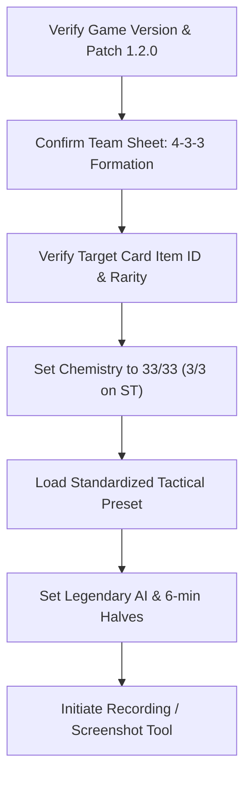

# Controlled Match Test Protocol (SOP-33-01)
## Standard Operating Procedure for FC27 Empirical Match Ingestion

**Document Code:** `SOP-33-01`  
**Target:** EA SPORTS FC 27 Match Execution & Annotation  
**Applies to:** Certified Field Operators, Data Annotators & Video Verification Specialists  

---

## 1. Pre-Match Setup Checklist

Before initiating any experimental match block, the operator MUST complete and verify the following pre-flight checklist:

### Verification Parameters:
1. **Card Identity Check:** Check player biography in Ultimate Team or Team Management. Ensure Dembélé is 90 OVR Rare Gold (`231443`) and Mbappé is 91 OVR Rare Gold (`231747`). Do NOT use loan items, evolution versions, or special in-form cards.
2. **Tactical Sliders:**
   - **HIGH_PRESS:** Defensive Style: *Constant Pressure*, Width: *50*, Depth: *75*, Build Up Play: *Balanced*, Chance Creation: *Direct Passing*, ST Role: *Advanced Forward*, ST Instructions: *Stay Central, Press Back Line, Normal Interceptions*.
   - **COUNTER_ATTACK:** Defensive Style: *Drop Back*, Width: *45*, Depth: *35*, Build Up Play: *Fast Build Up*, Chance Creation: *Forward Runs*, ST Role: *Advanced Forward*, ST Instructions: *Get In Behind, Stay Central, Conservative Interceptions*.
3. **Environment:** No active gameplay sliders (User and CPU gameplay sliders must remain at default $50$).

---

## 2. Match Execution Rules

1. **Duration:** Play full 90 minutes. Do not pause for more than 30 seconds unless necessary.
2. **Substitutions:** Do NOT substitute the test striker under any circumstances. If the striker receives a red card or injury forcing substitution, the match is voided (see Section 4).
3. **Player Fatigue Management:** Do NOT use team press d-pad overlays during non-press matches. Do NOT trigger keeper rushes that distort forward defensive positioning.
4. **Natural Play:** The operator must play to win the match naturally. Do not artificially force passes to the test striker or deliberately tackle unnecessarily; execute sound football tactics appropriate for the tactical instruction.

---

## 3. Post-Match Data Extraction & Provenance

Immediately upon the referee's final whistle:
1. Navigate to **Match Facts** $\rightarrow$ **Player Performance**.
2. Select the test striker and capture high-resolution screenshots of:
   - Screen 1: Summary (Rating, Goals, Assists, Minutes, Stamina, Total Distance).
   - Screen 2: Shooting & Passing (Shots, Shots on Target, Shot Locations, Passes Completed, Pass Accuracy).
   - Screen 3: Defending & Physical (Tackles Attempted, Tackles Won, Interceptions, Fouls, Duels Won).
3. Save screenshots into local evidence repository with format:
   `evidence/{protocol_key}/{match_key}_p{screen_index}.png`
4. Compute SHA-256 hash of the primary screenshot file and record as `evidence_locator`.
5. Enter exact values into `EXPERIMENT_ASSIGNMENTS.csv`.

---

## 4. Deviation & Replacement Protocol

A match block consists of a matched pair of games: Card A and Card B under the same tactic and session.

### Valid Deviations Requiring Invalidation:
- Connection disconnect or server crash.
- Red card shown to test striker or opponent center-back before minute 75.
- Striker forced substitution due to severe injury.
- Controller battery disconnect or hardware lag lasting $> 10$ seconds.
- Accidental variation in tactical sliders or chemistry.

### Mandatory Pair-Discard Invariant:
If ANY match within a block suffers a deviation:
1. Mark the deviant row's `deviation` column with the exact reason (e.g. `disconnect`, `striker red card`).
2. Mark the OTHER match in the same block as `deviation: discarded block`.
3. Do NOT discard only one match of the pair. Unbalanced pairs destroy counterbalancing.
4. Schedule a replacement pair with suffix `-retry` (e.g. `m1-retry`, `m2-retry`).
5. Keep both original deviated rows in the permanent ledger for honest auditing.
