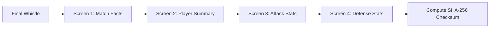

# FC27 Match Annotation & Verification Field Guide
## Operational Manual for Human Operators & Data Reviewers

**Manual ID:** `GUIDE-33-OPS`  
**Target:** EA SPORTS FC 27 Match Annotation  
**Target Audience:** Independent QA Testers, Gameplay Observers, Empirical Reviewers  

---

## 1. Scope & Objective

This field guide instructs observers on how to record and annotate in-game performance metrics from EA FC 27 matches with zero ambiguity. The primary purpose is producing uncompromised, verifiable empirical evidence to validate or falsify V3.2.1 recommendation engine predictions.

---

## 2. In-Game Screenshot & Verification Procedure

At the conclusion of each match, the operator MUST navigate to the official post-game statistical menus before exiting the match lobby.

### Required Screen Captures:
1. **Screen 1: Match Facts Summary**
   - Displays full-time score, possession percentage, total team shots, tackles, and fouls.
   - Purpose: Verifies opponent difficulty, game mode, and match completion without early forfeit.
2. **Screen 2: Target Player Summary Tab**
   - Highlight the test striker card.
   - Displays: Match Rating, Goals, Assists, Minutes Played, Stamina Remaining (gauge), Total Sprints.
3. **Screen 3: Target Player Attack & Shooting Tab**
   - Displays: Total Shots, Shots on Target, Shot Conversion, Pass Accuracy, Crosses.
4. **Screen 4: Target Player Defense & Physical Tab**
   - Displays: Tackles Attempted, Tackles Won, Interceptions, Aerial Duels Won, Fouls Committed.



---

## 3. Metric Extraction Rules

| Field Name | In-Game Screen Label | Annotation Rule | Valid Range |
| :--- | :--- | :--- | :---: |
| `minutes` | Time Played | Enter exact integer minutes. Standard match is 90. | $1 - 120$ |
| `goals` | Goals | Number of goals credited to the target player. | $\ge 0$ |
| `shots_on_target` | Shots on Target | Official shots requiring a goalkeeper save or resulting in goal. | $\ge \text{goals}$ |
| `shots` | Total Shots | Total attempted shots (including blocked shots and off-target). | $\ge \text{shots\_on\_target}$ |
| `tackles_won` | Tackles Won | Clean standing tackles resulting in possession change or turnover. | $\ge 0$ |
| `interceptions` | Interceptions | Ball path interruptions resulting in possession retention. | $\ge 0$ |
| `passes_completed`| Passes Completed | Accurately completed ground, lob, or through passes. | $\le \text{passes\_attempted}$ |
| `passes_attempted`| Passes | Total passes initiated by the player. | $\ge \text{passes\_completed}$ |

> [!CAUTION]
> **Zero vs Blank Rule:**
> If a player attempted zero tackles and won zero, enter `0`.
> If a stat was not tracked or cut off in the screenshot, leave the field **completely blank** (`null` / empty string). Never write `0` for an unobserved statistic.

---

## 4. Handling Deviations & Invalidation Scenarios

When an uncontrolled event disrupts match integrity, observers must apply the strict pair-invalidation protocol:

1. **Early Disconnection / Server Timeout:**
   - If match terminates before 90 minutes, mark `deviation: disconnection`.
   - Mark the companion match in the block as `deviation: discarded block`.
2. **Early Red Card:**
   - If the target striker or an opposing center-back receives a red card prior to minute 75, mark `deviation: early red card`.
3. **Accidental Tactical Slider Drift:**
   - If team depth, width, or striker instructions differ from pre-registered configuration, mark `deviation: slider error`.
4. **Replacement Pair Scheduling:**
   - Both matches are replayed with suffix `-retry1` (e.g., `s1-b1-m1-retry1` and `s1-b1-m2-retry1`).
   - The original deviated rows are retained in the master sheet with non-empty `deviation` column for forensic transparency.

---

## 5. Provenance & Cryptographic Archiving

- Save all four capture screenshots in a directory named `evidence/fc27-st-press-counter-r1/`.
- File naming pattern: `{match_key}_p{screen_index}.png`
- Generate SHA-256 hash using terminal command:
  ```powershell
  Get-FileHash evidence/fc27-st-press-counter-r1/fc27-st-press-counter-r1-s1-b1-m1_p1.png -Algorithm SHA256
  ```
- Copy the resulting hash hex string into the `evidence_locator` field of `EXPERIMENT_ASSIGNMENTS.csv`.
- This ensures third-party reviewers can verify that raw post-match screens were not altered post-hoc.
