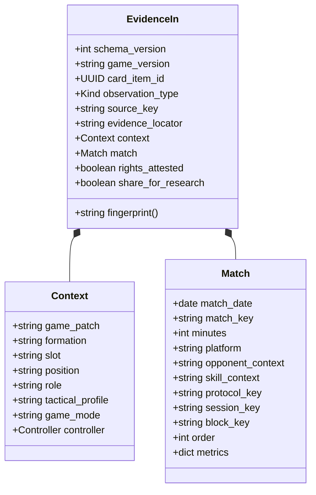

# Match Observation Data Schema Specification
## Phase 33: Empirical Gameplay Validation & Data Ingestion

**Schema Version:** `1.1.0-phase33`  
**Governing Standard:** Pydantic V2 / JSON Schema Draft-07  
**Enforcement Policy:** Zero Fabrication, Zero Imputation, Strict Cryptographic Provenance  

---

## 1. Schema Architecture Overview

The Match Observation Schema defines the contract for ingesting real FC27 gameplay evidence into EA FC Intelligence. It ensures that no subjective opinion or unverified claim can masquerade as controlled empirical performance data.



---

## 2. Pydantic Model Definitions

```python
from datetime import date
from typing import Annotated, Literal
from uuid import UUID
from pydantic import BaseModel, ConfigDict, Field, StringConstraints, model_validator

Kind = Literal[
    "CONTROLLED_EXPERIMENT",
    "OWNER_RECORDED_MATCH",
    "USER_SUBMITTED_MATCH",
    "COMMUNITY_OPINION",
    "CREATOR_OBSERVATION"
]

Metric = Literal[
    "goals", "assists", "shots", "shots_on_target",
    "passes_completed", "passes_attempted",
    "tackles_won", "interceptions", "saves", "shots_faced"
]

Patch = Annotated[str, StringConstraints(pattern=r"^[0-9]+\.[0-9]+(?:\.[0-9]+){0,2}$", max_length=20)]
Code = Annotated[str, StringConstraints(strip_whitespace=True, min_length=1, max_length=80, pattern=r"^[\w.:-]+$")]
Label = Annotated[str, StringConstraints(strip_whitespace=True, min_length=1, max_length=100)]


class Context(BaseModel):
    model_config = ConfigDict(extra="forbid")
    game_patch: Patch
    formation: Label
    slot: Label
    position: Label
    role: Label
    tactical_profile: Label
    game_mode: Label
    controller: Literal["HUMAN", "AI", "MIXED"]


class Match(BaseModel):
    model_config = ConfigDict(extra="forbid")
    match_date: date
    match_key: Code
    minutes: int = Field(ge=1, le=120, strict=True)
    platform: Label
    opponent_context: Label
    skill_context: Label
    session_key: Code
    setup_key: Code
    protocol_key: Code
    block_key: Code
    order: Literal[1, 2]
    metrics: dict[Metric, int | None] = Field(default_factory=dict)

    @model_validator(mode="after")
    def validate_arithmetic_consistency(self):
        # Arithmetical invariants
        pairs = [
            ("goals", "shots_on_target"),
            ("shots_on_target", "shots"),
            ("passes_completed", "passes_attempted"),
            ("saves", "shots_faced")
        ]
        for num, den in pairs:
            v_num, v_den = self.metrics.get(num), self.metrics.get(den)
            if v_num is not None and v_den is not None and v_num > v_den:
                raise ValueError(f"Arithmetic violation: {num} ({v_num}) cannot exceed {den} ({v_den})")
        return self


class EvidenceIn(BaseModel):
    model_config = ConfigDict(extra="forbid")
    schema_version: Literal[1] = 1
    game_version: Literal["FC27"]
    card_item_id: UUID
    observation_type: Kind
    source_key: Code
    evidence_locator: Label
    context: Context
    match: Match
    rights_attested: Literal[True]
    share_for_research: bool = True
```

---

## 3. Mandatory Ingestion Invariants

1. **Exact Patch Matching:**
   Observations recorded on differing game patches (e.g., `1.2.0` vs `1.3.0`) are quarantined into distinct strata. The engine will NEVER pool rates across different title update patches.
2. **Paired Counterbalancing:**
   A match observation for Card A under tactic $T$ is unusable for comparative analysis unless accompanied by a matching Card B observation within the exact same `session_key`, `block_key`, `opponent_context`, and `setup_key`.
3. **No Metric Imputation:**
   If an operator fails to track `interceptions` in a match, the field MUST remain `None`. The system will NEVER substitute $0$, the cohort mean, or a regression estimate.
4. **Conflict Quarantine:**
   If the same `(card_item_id, match_key)` pair is submitted with divergent metrics from multiple reporters, both records are instantly quarantined as `CONFLICTING_MATCH_REPORTS` and withheld from recommendation calculations.
