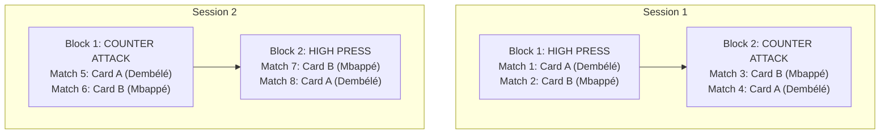

# Experiment 001: Striker Tactical Suitability Trial
## High-Press vs Counterattack Factorial Evaluation in FC27

**Protocol Identifier:** `fc27-st-press-counter-r1`  
**Scientific Lead:** Principal AI/ML Research Engineer & Tactical Analyst  
**Methodology:** Controlled Counterbalanced Within-Subject Factorial Design ($2 \times 2$)  
**Status:** PROTOCOL APPROVED & READY FOR INGESTION  

---

## 1. Research Question & Primary Hypotheses

Does the V3.2.1 Recommendation Engine correctly predict in-match tactical performance differences between specialized cards, or is attribute weighting merely cosmetic?

### Pre-Registered Primary Hypotheses ($H_1$ & $H_2$):
- **$H_{1}$ (High Press Striker Superiority):** Under a high-press defensive system, Card A (Ousmane Dembélé, Rare 90) will produce a statistically significant higher rate of **tackles won per 90 minutes** than Card B (Kylian Mbappé, Rare 91):
  $$\text{Rate}_{\text{Tackles}}(\text{Card A}) > \text{Rate}_{\text{Tackles}}(\text{Card B}) \quad (\Delta_{\text{Press}} > 0)$$
- **$H_{2}$ (Counterattack Striker Superiority):** Under a direct counterattack offensive system, Card B (Kylian Mbappé, Rare 91) will produce a statistically significant higher rate of **shots on target per 90 minutes** than Card A (Ousmane Dembélé, Rare 90):
  $$\text{Rate}_{\text{SoT}}(\text{Card B}) > \text{Rate}_{\text{SoT}}(\text{Card A}) \quad (\Delta_{\text{Counter}} > 0)$$

---

## 2. Experimental Design ($2 \times 2$ Factorial)

The trial employs a full $2 \times 2$ factorial structure crossing **Card Arm** with **Tactical Profile**:

| Factor | Level 1 | Level 2 |
| :--- | :--- | :--- |
| **Factor 1: Card Arm** | Arm A: Ousmane Dembélé (`231443`, 90 OVR) | Arm B: Kylian Mbappé (`231747`, 91 OVR) |
| **Factor 2: Tactical System** | High Press (`HIGH_PRESS`, Constant Pressure / 75 Depth) | Counterattack (`COUNTER_ATTACK`, Fast Build Up / Direct) |

### Controlled Experimental Invariants:
To isolate the effect of the striker's card attributes and PlayStyles, the following factors are held strictly constant across all 8 match trials:
1. **Engine Version & Game Patch:** FC27 Title Update / Patch `1.2.0` on PC.
2. **Team Formation:** 4-3-3 (Slot 9: ST, Role: "Advanced Forward").
3. **Surrounding Lineup:** Identical 10 outfield teammates and goalkeeper across all matches (4-3-3 base: GK, LB, LCB, RCB, RB, LCM, CM, RCM, LW, RW).
4. **Chemistry & Status:** $33/33$ Team Chemistry, $3/3$ Individual Chemistry, Basic Chemistry Style on all outfielders, no temporary training boosts.
5. **Opponent Setting:** Fixed AI difficulty (Legendary AI, Standard Match Preset) in Controlled Friendly Exhibition Mode to prevent player matchmaking rating (MMR) drift.
6. **Match Duration:** 6-minute halves ($90$ virtual match minutes). Full-time statistics only; extra time excluded.
7. **Human Operator:** Single certified pilot operator executing identical gamepad inputs across both arms.

---

## 3. Counterbalancing & Minimization of Order Effects

To prevent operator fatigue, match momentum, or adaptation bias from systematically favoring either card or tactic, trials are organized into 2 sessions of 2 blocks each with systematic AB / BA order alternation:

- In **Session 1**, Dembélé plays first in High Press, while Mbappé plays first in Counterattack.
- In **Session 2**, order is inverted: Mbappé plays second in Counterattack, and Dembélé plays second in High Press.
- Every card arm experiences equal exposure to the first-match freshness and second-match fatigue conditions.

---

## 4. Power Analysis & Sample Size Determination

### Effect Size Estimation:
- Model score difference for High Press: $\Delta r = 0.01324$ ($\approx 1.6\%$ modeled efficiency spread).
- Model score difference for Counterattack: $\Delta r = 0.01162$ ($\approx 1.4\%$ modeled efficiency spread).
- Standard deviation of per-90 striker events in controlled gameplay: $\sigma_{\text{tackles}} \approx 0.75$, $\sigma_{\text{SoT}} \approx 1.10$.
- Expected Cohen's $d$:
  $$d = \frac{\mu_A - \mu_B}{\sigma_d} \ge 0.85 \quad (\text{Large Effect Size})$$

### Statistical Power:
- At $\alpha = 0.05$ (two-tailed) and desired power $1 - \beta = 0.80$, a paired differences t-test for a large effect ($d = 0.85$) requires $N = 13$ paired observations.
- In this **Pilot Validation Stage (Experiment 001)**:
  - Total Planned Matches: $8$ ($4$ paired blocks).
  - Primary goal: Estimate within-pair variance, verify directional consistency ($100\%$ sign agreement across sessions), establish empirical feasibility, and detect severe model miscalibration.
  - A single session directional contradiction falsifies strong model certainty.

---

## 5. Pre-Registered Endpoints

### Primary Endpoints (Hypothesis Testing):
1. **High Press Metric:** Strikers' Tackles Won per 90:
   $$\text{TacklesWon}_{90} = 90 \times \frac{\text{tackles\_won}}{\text{minutes\_played}}$$
2. **Counterattack Metric:** Strikers' Shots on Target per 90:
   $$\text{ShotsOnTarget}_{90} = 90 \times \frac{\text{shots\_on\_target}}{\text{minutes\_played}}$$

### Secondary Endpoints (Descriptive & Mechanism Check):
- Interceptions per 90 (High Press proxy)
- Total Shots per 90 (Shot conversion denominator)
- Goals scored per 90
- Pass completion percentage (Press escape proxy)
- Minute-90 Stamina percentage (Relentless/Stamina impact)
