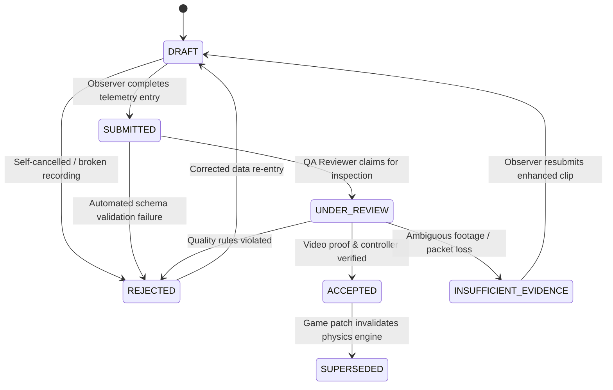

# EA FC INTELLIGENCE — PHASE 35
# EMPIRICAL OBSERVATION SCHEMA & LIFECYCLE SPECIFICATION

**Version:** 1.0.0-phase35  
**Domain Module:** `backend/domain/empirical_observation.py`  
**Classification:** Research Data Engineering & Empirical Validation  

---

## 1. Overview & Purpose

The Empirical Observation System provides an immutable, verifiable schema for ingesting, validating, and reviewing gameplay telemetry observed during controlled match trials. 

Prior to Phase 35, the platform relied exclusively on deterministic attribute models (`V3.2.1`). This schema establishes the formal bridge between theoretical model predictions and real-world gameplay evidence, ensuring:
- Full traceability from raw video/spectator capture to statistical hypothesis tests.
- Strict anti-cheating, controller configuration, and latency filtering.
- State-machine lifecycle governance (`DRAFT` $\to$ `SUBMITTED` $\to$ `UNDER_REVIEW` $\to$ `ACCEPTED` / `REJECTED`).

---

## 2. Schema Architecture

```
+-----------------------------------------------------------------------------------+
|                           EmpiricalObservationRecord                              |
+-----------------------------------------------------------------------------------+
|  observation_id: UUID (Primary Key)                                               |
|  experiment_id: str (e.g. "EXP-ST-PRESS-001")                                     |
|  session_id: str (Paired match block identifier)                                  |
|  tactical_profile: str (e.g. "HIGH_PRESS", "COUNTER_ATTACK")                      |
|  formation: str (e.g. "4-3-3")                                                    |
|  slot_evaluated: str (e.g. "ST")                                                  |
|  candidate_arm: "A" | "B"                                                         |
|  review_status: ReviewStatus                                                      |
|  verification_hash: str (SHA-256 integrity digest)                               |
+------------------------------------+----------------------------------------------+
                                     |
         +---------------------------+---------------------------+
         |                                                       |
+--------v----------------------+                       +--------v----------------------+
|        MatchMetadata          |                       |       ObserverMetadata        |
+-------------------------------+                       +-------------------------------+
|  match_id: str                |                       |  observer_id: str             |
|  match_timestamp: ISO-8601    |                       |  observer_handle: str         |
|  game_title: "FC27" | "FC26"  |                       |  capture_method:              |
|  patch_version: str           |                       |    VIDEO_OCR | API_SPECTATOR  |
|  game_mode: GameMode          |                       |    MANUAL_TALLY | EVENT_LOG   |
|  difficulty: str              |                       |  video_proof_url: Optional[str]|
|  half_length_mins: int        |                       |  client_signature: str        |
|  tactical_defending: bool     |                       +-------------------------------+
|  pass_assist: AssistEnum      |                                        |
|  shot_assist: AssistEnum      |                       +----------------v--------------+
|  connection_ping_ms: float    |                       |      PerformanceMetrics       |
|  input_delay_rating: str      |                       +-------------------------------+
|  dnf: bool                    |                       |  card_item_id: str            |
|  final_minute_reached: int    |                       |  minutes_played: int          |
+-------------------------------+                       |  goals / assists / xg: float  |
                                                        |  shots / shots_on_target: int |
                                                        |  tackles_won / intercepts: int|
                                                        |  final_third_presses: int     |
                                                        |  turnovers_forced_final_third |
                                                        |  transition_recoveries: int   |
                                                        |  aerial_duels_won: int        |
                                                        +-------------------------------+
```

---

## 3. Review Lifecycle State Machine

Every observation must progress through a formal state machine to prevent unvetted or biased data from entering statistical evaluation cohorts:



### State Descriptions:
1. **`DRAFT`:** Initial record created by the observer during or immediately following match play.
2. **`SUBMITTED`:** Observer has submitted telemetry, triggering automated schema checks (valid timestamps, non-negative counts, valid card IDs).
3. **`UNDER_REVIEW`:** Independent reviewer or automated validation suite is inspecting controller settings, difficulty confirmation, and video proof.
4. **`ACCEPTED`:** Record passes 100% of quality validation rules. A deterministic cryptographic hash is computed and stamped onto the record.
5. **`REJECTED`:** Match terminated early (< 75 min), controller assist was illegal, or data tampering detected.
6. **`INSUFFICIENT_EVIDENCE`:** Video footage incomplete, frame rate dropped during key sequence, or observer telemetry ambiguous.
7. **`SUPERSEDED`:** An accepted observation rendered obsolete due to a title patch altering underlying gameplay physics.

---

## 4. Cryptographic Integrity Digest

When an observation transitions to `ACCEPTED`, a SHA-256 verification digest is computed:

$$\text{Digest} = \text{SHA256}\left(\text{observation\_id} \parallel \text{experiment\_id} \parallel \text{session\_id} \parallel \text{card\_item\_id} \parallel \text{minutes\_played} \parallel \text{primary\_metric}\right)$$

This digest is stored in the database and immutable manifest to guarantee that match data cannot be retroactively altered to fit model biases.
