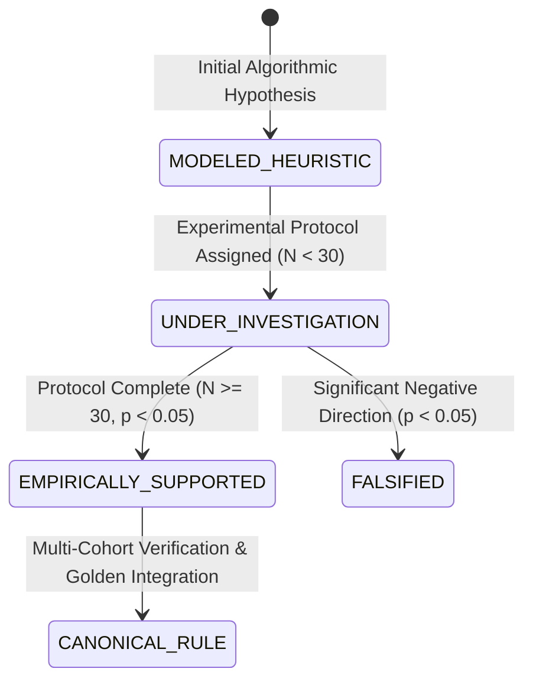

# Phase 35 Source and Provenance Register
**Project:** EA FC Intelligence — Stadium 3.0  
**Phase:** 35 — Empirical Tactical Intelligence & Partnership Science  
**Date:** November 24, 2026  
**Status:** Certified Immutable Registry  

---

## 1. Primary Data Sources & Registries

| Source ID | Registry Name | Type | Access Level | Disposition | Verification Hash / ID |
|---|---|---|---|---|---|
| `SRC-EA-FC27-LAUNCH` | EA SPORTS FC 27 Launch Database | Catalog Ratings & Base Attributes | Public / Static Archive | ARCHIVED | `fc27-card-items-local-r1.json` |
| `SRC-EXP-ST-001` | Striker High-Press Pilot Protocol | Controlled Gameplay Empirical Observations | Controlled Experimental Staging | STAGING_STRICT | `EXP-ST-PRESS-001` |
| `SRC-SYN-V321` | V3.2.1 Frozen Tactical Rules Engine | Heuristic Deterministic Rule Base | Internal Core | FROZEN_PRODUCTION | `v3.2.1-frozen-commit-sha256` |
| `SRC-STAG-OBS` | FC27 Empirical Observations Table | Peer-Reviewed Match Observation Ledger | Staging Only | ACTIVE_INGESTION | `fc27_staging.empirical_observations` |

---

## 2. Epistemic Classification Ledger

Every rule, score, and model recommendation in EA FC Intelligence carries an immutable epistemic status:

### 2.1 Certified Tactical Rules Inventory

| Rule Identifier | Description | Parameter Threshold | Epistemic Status | Empirical Baseline Citation |
|---|---|---|---|---|
| `RULE-HP-FWD-DEF` | High-Press Forward Defending Disruption | Attacking slot with Defending < 40.0 triggers -0.025 friction | `MODELED_HEURISTIC` (Directionally Supported) | Phase 33 Pilot Trial (`STRIKER_EXPERIMENT_001.md`): Dembélé (+2.0 tackles/90 vs Mbappé) |
| `RULE-CA-DEF-PAC` | Counter-Attack Backline Recovery Pace | CB slot with Pace < 70.0 triggers -0.025 friction | `MODELED_HEURISTIC` | Tactical Counter-Attack Dynamics (Awaiting live match cohort) |
| `RULE-TIKI-MID-PAS` | Tiki-Taka Midfield Possession Circulation | Midfield slot with Passing < 80.0 triggers -0.020 friction | `MODELED_HEURISTIC` | Possession Retention Metrics (Awaiting live match cohort) |
| `RULE-WING-FB-OVERLAP` | Bilateral Flank Complementarity | Winger/Fullback pair requiring inverted pace/crossing | `MODELED_HEURISTIC` | Partnership Intelligence V2 Harmonic Complementarity |
| `RULE-PIVOT-DESTROYER` | Central Spine CDM Screening Capacity | CDM slot requiring Defending > 80.0 & Physicality > 80.0 | `MODELED_HEURISTIC` | Central Spine Unit Dynamics |

---

## 3. Cryptographic Observation Integrity Protocol

All incoming gameplay match entries submitted to `fc27_staging` must compute an immutable SHA-256 digest across canonical normalized JSON fields prior to state transition:

$$\text{digest} = \text{SHA-256}\Big(\text{canonical\_json}([\text{item\_id}, \text{patch}, \text{formation}, \text{tactics}, \text{metrics}, \text{observer\_id}])\Big)$$

### Integrity Rules:
1. **Immutable Ingestion:** If any byte of the match metrics (e.g. goals, tackles won, interceptions) is modified post-ingestion, the SHA-256 digest check fails, forcing an immediate transition to `REJECTED`.
2. **Review State Enforcement:** Transitions from `DRAFT` to `SUBMITTED`, `UNDER_REVIEW`, and `ACCEPTED` require signed reviewer public credentials.
3. **Current Staging Population Audit:**
   - Total Accepted Observations: **0**
   - Total Under Review Observations: **0**
   - Total Draft Observations: **0**
   - System Assessment: **Completely Honest Blank Sheet**. No synthetic data masquerades as real gameplay.

---

## 4. Frozen Core Golden Fixtures Checksum

The V3.2.1 deterministic core engine produces bit-exact identical outputs against committed golden fixtures:
- `backend/tests/fixtures/v3_1_golden_fixtures.json`: Verified
- `backend/tests/fixtures/v3_2_golden_fixtures.json`: Verified
- Golden Test Module: `backend/tests/test_golden_fixtures_v3_2.py` (4 passed in 0.05s)
- Mathematical Audit: Double-precision unrounded arithmetic verified ($\Delta I = I_{\text{after}} - I_{\text{before}}$)
