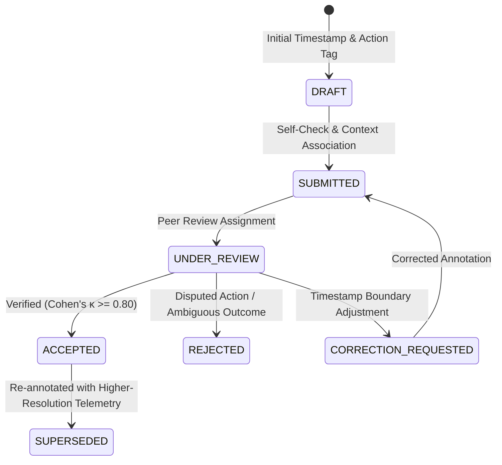

# Phase 36 Match Event Annotation Protocol
**Project:** EA FC Intelligence — Stadium 3.0  
**Phase:** 36 — Video Gameplay Intelligence & Empirical Validation  
**Date:** November 24, 2026  
**Standard:** Double-Blind Ground-Truth Event Annotation  

---

## 1. Annotation Protocol Lifecycle

To prevent researcher confirmation bias and ensure high inter-annotator reliability, all manual and CV-assisted annotations follow a strict multi-stage lifecycle:



---

## 2. Temporal & Spatial Standards

### 2.1 Timestamp Boundary Precision
- **Resolution:** Millisecond accuracy (`HH:MM:SS.mmm` or float seconds).
- **Lead-In & Lead-Out Window:**
  - Fast physical actions (shots, tackles, passes): 0.5s pre-action buffer, 1.0s post-action buffer.
  - Tactical phases (pressing sequence, attacking transition): Bound the entire continuous engagement (typically 3.0s to 8.0s).
- **Discontinuity Handling:** Any event spanning a broadcast camera cut or replay must be split or flagged with `VIDEO_EDIT`.

### 2.2 Standard 18-Zone Tactical Pitch Grid
The virtual pitch ($105\text{m} \times 68\text{m}$) is segmented into standard tactical zones:

```text
+-----------------------+-----------------------+-----------------------+
|  Zone 1: Left Wing    |  Zone 2: Left Mid     |  Zone 3: Left Back    |  (Left Flank)
+-----------------------+-----------------------+-----------------------+
|  Zone 4: Left Half-Sp |  Zone 5: Left Center  |  Zone 6: Left Def-Sp  |  (Left Half-Space)
+-----------------------+-----------------------+-----------------------+
|  Zone 7: Center Box   |  Zone 8: Center Mid   |  Zone 9: Penalty Box  |  (Central Spine)
+-----------------------+-----------------------+-----------------------+
|  Zone 10: Rt Half-Sp  |  Zone 11: Rt Center   |  Zone 12: Rt Def-Sp   |  (Right Half-Space)
+-----------------------+-----------------------+-----------------------+
|  Zone 13: Right Wing  |  Zone 14: Right Mid   |  Zone 15: Right Back  |  (Right Flank)
+-----------------------+-----------------------+-----------------------+
```

---

## 3. Card Identity Resolution Standard

When tagging a player involved in an event:
1. **Tier 1 — Confirmed Item ID (`HIGH_CONFIDENCE`):**
   - Exact card confirmed via pre-match squad screen, card dynamic image, and unique attribute combination.
   - Example: Kylian Mbappé Gold 91 (`card_item_id: 97aaac8f-1616-50a0-afea-fd8aeff337ce`).
2. **Tier 2 — Provisional Footballer (`PROVISIONAL`):**
   - Footballer name recognized via HUD overhead marker, but card edition unconfirmed (e.g. could be Gold 91 or Inform 92).
   - Stored with `candidate_base_player_id`.
3. **Tier 3 — Unresolved Slot (`UNRESOLVED`):**
   - Role/position visible on pitch (e.g., "Opponent LCB"), but exact player name obscured by camera distance.
   - Stored with `formation_slot: "LCB"`, `player_identity: "UNKNOWN"`.

---

## 4. Quality Control & Conflict Resolution

- **Non-Destructive Correction:** Modifying an event creates a new version record while preserving the historical reviewer notes and previous timestamp boundaries.
- **Inter-Rater Reliability Threshold:** Minimum agreement threshold across paired annotators is set to Cohen's $\kappa \ge 0.80$ for event type and $\kappa \ge 0.75$ for event outcome before promotion to `ACCEPTED`.
