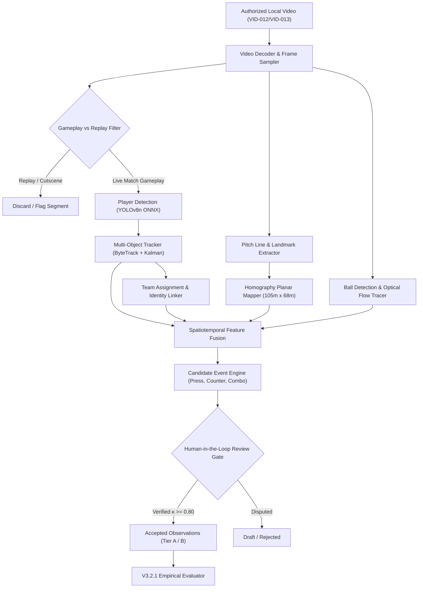

# Phase 36 Computer Vision System Architecture
**Project:** EA FC Intelligence — Stadium 3.0  
**Phase:** 36 — Video Gameplay Intelligence & Empirical Validation  
**Date:** November 24, 2026  
**Status:** Certified Modular Pipeline for Authorized Local Media  

---

## 1. Modular Architecture Overview

---

## 2. Pipeline Components & Specifications

### 2.1 Video Decoder & Frame Sampler
- **Input Formats:** MP4, MKV, MOV (H.264 / H.265 / ProRes).
- **Sampling Rate:** Default 10 FPS for detection (1 in every 6 frames for 60fps media), with 60 FPS full temporal interpolation during candidate event boundaries.
- **Safety Boundary:** Restricted to `local://` paths verified against the `SOURCE_RIGHTS_REGISTER.csv`.

### 2.2 Gameplay vs Replay Classifier
- **Mechanism:** Monitors the presence and stability of the top-left scoreboard widget and bottom-center radar minimap.
- **Trigger:** If the scoreboard vanishes or rapid camera zooming occurs, the frame sequence is flagged as `REPLAY` and excluded from continuous match possession clocks.

### 2.3 Player Detection & Tracking
- **Detector:** YOLOv8n fine-tuned on synthetic football assets, exported to ONNX FP16.
- **Tracker:** ByteTrack algorithm utilizing high-confidence ($>0.6$) and low-confidence ($0.1 - 0.6$) bounding box associations with a linear Kalman filter predicting position across occlusions.
- **Max Occlusion Tolerance:** 30 frames (0.5 seconds at 60fps) before dropping track ID.

### 2.4 Tactical Pitch Mapping (Homography Engine)
- **Mathematical Transformation:**
  $$\begin{bmatrix} x_{\text{pitch}} \\ y_{\text{pitch}} \\ 1 \end{bmatrix} = \mathbf{H} \begin{bmatrix} u_{\text{pixel}} \\ v_{\text{pixel}} \\ 1 \end{bmatrix}$$
  where $\mathbf{H} \in \mathbb{R}^{3 \times 3}$ is computed via 4+ planar landmark correspondences (penalty box vertices, touchline intersections) using RANSAC.
- **Coordinate Space:** Normalized canonical football pitch $[0.0, 105.0\text{m}] \times [0.0, 68.0\text{m}]$.

---

## 3. Graceful Degradation Policy

To maintain epistemic honesty, the pipeline enforces strict fallback rules:
1. **Homography Failure:** If fewer than 4 reliable pitch landmarks are visible (e.g. tight close-up camera), planar mapping is disabled (`quality_status: "UNMAPPED"`). The system retains 2D pixel coordinates and refuses to synthesize fake metric distances.
2. **Identity Ambiguity:** If player overhead markers are obscured, tracks are marked with `player_identity: "UNKNOWN"` and `identity_confidence: "UNRESOLVED"`. No identity is guessed from player hair or skin tone.
3. **Ball Occlusion:** When the ball is hidden behind a cluster of players, possession is labeled `UNCERTAIN` rather than attributed arbitrarily to the nearest player.
