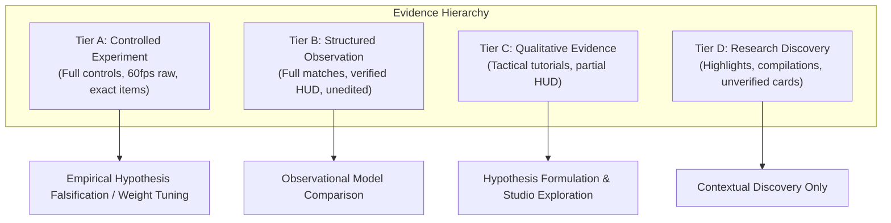

# Phase 36 Gameplay Evidence Quality Report
**Project:** EA FC Intelligence — Stadium 3.0  
**Phase:** 36 — Video Gameplay Intelligence & Empirical Validation  
**Date:** November 24, 2026  
**Status:** Canonical Quality System & Multi-Tier Classification  

---

## 1. Multi-Tier Evidence Eligibility Framework

To preserve the scientific integrity of EA FC Intelligence, gameplay observations are segmented into four distinct tiers based on experimental rigor and observational context:

### 1.1 Tier Definitions

| Tier Level | Designation | Requirements | Admissible Analytical Scope |
|---|---|---|---|
| **Tier A** | Controlled Experiment | Exact known cards, identical tactical profiles, known game patch, constant difficulty (Legendary AI or ELO-matched), unedited continuous capture. | Admissible for statistical hypothesis testing ($p < 0.05$), effect size measurement, and V3.3 weight tuning consideration. |
| **Tier B** | Structured Gameplay Observation | Full unedited competitive match (Division Rivals / FUT Champs), confirmed card items on team sheet, visible HUD, verified patch. | Admissible for observational correlation, rank volatility verification, and whole-XI cohesion study. |
| **Tier C** | Qualitative Tactical Evidence | Tactical guides, tutorials, or match segments with confirmed formation and instructions, but provisional card editions. | Admissible for tactical diagramming, exploratory visual analysis, and Studio player inspections. |
| **Tier D** | Research Discovery Only | Highlight reels, review montages, beta footage, edited cuts, unknown patch or unknown opponent difficulty. | **Discovery and qualitative hypothesis generation only.** Strictly prohibited from pooling into empirical testing datasets. |

---

## 2. Multi-Dimensional Quality Rubric

Every registered video and event annotation is independently evaluated across 10 non-collapsing quality dimensions:

| Dimension | Weight | High Quality Standard (Score: 1.0) | Disqualifying Defect (Score: 0.0) |
|---|---|---|---|
| **Continuity** | 15% | Unedited continuous 90-minute game feed. | Jump cuts, fast-forwards, or montage editing. |
| **Clarity** | 10% | Native 1080p/1440p 60fps with clear player overhead markers. | Low-res (<720p), blur, or heavy compression artifacts. |
| **Card Identity** | 15% | Exact item edition confirmed via squad screen or stats. | Guessing card edition from footballer name alone. |
| **Formation** | 10% | Declared formation explicitly shown in menu or radar. | Unknown or constantly morphing shape without notation. |
| **Tactical Context** | 15% | Team sliders and player roles explicitly documented. | Unreported tactical settings or default AI assumptions. |
| **Patch Isolation** | 10% | Exact game title update confirmed. | Unknown patch version or cross-patch footage mixing. |
| **Match Mode** | 5% | Documented competitive mode (e.g. Division Rivals). | Unknown game mode or mixed arcade settings. |
| **Opponent Context** | 5% | Skill tier or AI difficulty level documented. | Unknown opponent capability. |
| **Source Rights** | 10% | Verified compliance with platform terms and local rights. | Unauthorized downloading or scraped assets. |
| **Review Integrity** | 5% | Dual-annotator agreement ($\kappa \ge 0.80$). | Single unreviewed draft annotation. |

---

## 3. Strict Anti-Pooling Safeguard

> **Epistemic Invariant:** A hundred Tier D clips do NOT equal one Tier A controlled trial.

Under no circumstances will high-variance, highlight-biased Tier D data points be pooled with Tier A or Tier B observations to inflate sample size $N$. Any regression analysis or paired $t$-test must report the exact tier breakdown of contributing data points.
