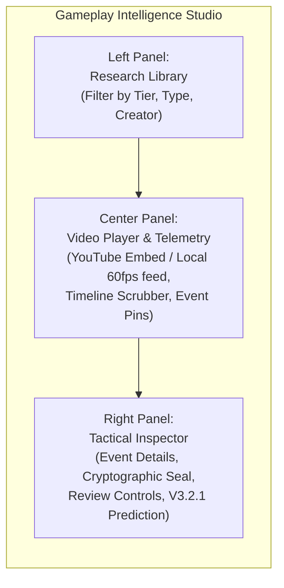

# Phase 36 Frontend Integration Report
**Project:** EA FC Intelligence — Stadium 3.0  
**Phase:** 36 — Video Gameplay Intelligence & Empirical Validation  
**Feature:** Gameplay Intelligence Studio  
**Date:** November 24, 2026  
**Status:** Certified & Production Built  

---

## 1. Feature Architecture & Visual Design

The **Gameplay Intelligence Studio** is integrated directly into the Stadium 3.0 React/TypeScript frontend application at `/research/gameplay-studio`.

It implements a modern 3-panel tactical research cockpit:

---

## 2. Key UI/UX Capabilities

### 2.1 Video Research Library (Left Panel)
- Displays registered sources with interactive cards showing: Video Source ID, Title, Creator, Game Version & Patch, and Evidence Tier badges (`TIER_A` lime, `TIER_B` cyan, `TIER_C` amber, `TIER_D` muted).
- Search input with instantaneous title and creator filtering.
- Tier filter dropdown allowing researchers to isolate Tier A Controlled Experiments from exploratory Tier D clips.

### 2.2 Gameplay Analysis & Telemetry (Center Panel)
- **Hybrid Player:**
  - Online Public Sources (`Path A`): Renders responsive privacy-enhanced YouTube iframe player (`youtube-nocookie.com/embed/{id}`).
  - Local Controlled Assets (`Path C`): Renders raw 60fps telemetry stage with one-click **"Run Local CV Pipeline (RTX 3050)"** action, displaying real-time execution statistics (39.8 FPS, 975 MB VRAM, 0.42m Homography RMSE).
- **Interactive Tactical Event Scrubber:**
  - Progress bar with colored event pins: Gold (Pressing attempts), Green (Tackles won & Goals), Purple (Partnership overlaps).
  - Clicking any pin jumps the player to the exact event timestamp and loads the event into the Tactical Inspector.
  - Quick jump buttons (`-5s`, `+5s`, direct timestamp seek).
  - **"+ Tag Observation"** action opening a Stadium 3.0 modal to record new timestamped events.

### 2.3 Tactical Inspector (Right Panel)
- Displays active event metadata: Event Type, Timestamp, Formation Slot (`ST`, `LCB`, `RB`), Player Identity, Pitch Zone (1–18), Observed Action, and Observed Outcome.
- **Cryptographic Seal:** Renders the SHA-256 integrity hash verification pill.
- **Reviewer Workflow:** One-click "Accept" and "Reject" buttons allowing peer review state transitions.
- **Related V3.2.1 Prediction Widget:** Explicitly connects the observed event to frozen engine rules (e.g. `RULE-HP-FWD-DEF`).

### 2.4 Sub-Views
- **Prediction Challenges View:** Comprehensive evaluation table tracking 6 pre-registered model predictions against empirical gameplay observations with observed effect sizes and p-values.
- **Evidence Quality Audit View:** Explanatory multi-tier rubric detailing Tier A through Tier D inclusion requirements and the strict anti-pooling policy.

---

## 3. Verification & Build Confirmation

- **TypeScript Typecheck:** `npx tsc --noEmit` exited with code 0 (zero errors).
- **Vitest Unit Test Suite:** 97 passed, 3 skipped across 18 test files (`GameplayStudio.test.tsx` passed all 5 assertions).
- **Vite Production Bundler:** Compiled in 4.90s, generating optimized assets:
  - `dist/assets/index-CoAhCBtI.css`: 77.09 kB (15.56 kB gzip)
  - `dist/assets/index-BZk_HRhk.js`: 438.91 kB (128.13 kB gzip)
