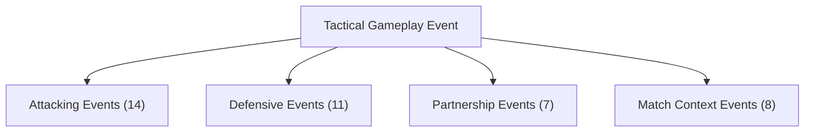

# Phase 36 Football Gameplay Event Taxonomy
**Project:** EA FC Intelligence — Stadium 3.0  
**Phase:** 36 — Video Gameplay Intelligence & Empirical Validation  
**Date:** November 24, 2026  
**Status:** Canonical Event Definitions & Operational Gating  

---

## 1. Overview & Operational Principles

To convert unstructured audiovisual gameplay footage into mathematically reconstructable empirical data, every football event must possess an unambiguous, mutually exclusive definition. 

### Operational Rules:
1. **Observable Action vs Subjective Intent:** An event must document strictly *observable physical behaviors on the virtual pitch* (e.g. distance closed, ball contact, velocity change), never unverified creator psychology (e.g. "player intended to pass").
2. **Action vs Outcome Separation:** An event action (e.g., `PRESS_ATTEMPT`) is tracked independently from its terminal outcome (e.g., `TURNOVER_WON`, `BEATEN_BY_DRIBBLE`, `FOUL_COMMITTED`).
3. **No Direct Chemistry Labeling:** Observable partnership successes must not be converted into invented chemical stat bonuses.

---

## 2. Event Category Taxonomy

### 2.1 Attacking Events

| Event Code | Event Name | Operational Definition | Observable Inclusion Criteria | Outcome Values |
|---|---|---|---|---|
| `PASS_ATTEMPT` | Pass Attempt | Ball propelled towards a teammate via ground or lofted input. | Departure of ball from passer foot towards candidate recipient. | `COMPLETED`, `INTERCEPTED`, `OUT_OF_BOUNDS`, `BLOCKED` |
| `PASS_COMPLETED` | Pass Completed | Successful receipt and control of a pass by a teammate. | Ball controlled within 2 touches by target player. | `SUCCESS` |
| `THROUGH_BALL` | Through Ball | Pass directed into open space ahead of a running receiver. | Pass travels between or behind opposing defensive lines. | `COMPLETED`, `CUT_OUT`, `HEAVY_TOUCH_TO_GK` |
| `PROGRESSIVE_PASS` | Progressive Pass | Pass that advances the ball towards opponent goal by $\ge 10\text{m}$ (or into penalty box). | Start/end pitch coordinate delta $\Delta x \ge 10\text{m}$. | `COMPLETED`, `INCOMPLETE` |
| `CROSS_ATTEMPT` | Cross Attempt | Delivery from wide flank zone (Pitch Zone 1, 3, 4, 6) into penalty box. | Ball crosses flank-to-box boundary in air or drilled along ground. | `HEADED_CLEAR`, `GOALKEEPER_CATCH`, `SHOT_PRODUCED` |
| `SHOT_ATTEMPT` | Shot Attempt | Direct intentional attempt to score towards opponent goal. | High-velocity ball trajectory oriented toward goal frame. | `ON_TARGET`, `OFF_TARGET`, `BLOCKED`, `POST` |
| `SHOT_ON_TARGET` | Shot on Target | Shot that would enter goal frame if not saved or blocked by last defender. | Trajectory within goal posts and under crossbar. | `SAVED`, `GOAL` |
| `GOAL` | Goal | Ball crosses goal line completely between posts. | Goal awarded on game scoreboard. | `GOAL_AWARDED` |
| `CHANCE_CREATION` | Chance Creation | Action immediately leading to a shot attempt ($xG \ge 0.10$). | Pass, cross, or dribble preceding a shot within 3 seconds. | `CHANCE_CONVERTED`, `CHANCE_MISSED` |
| `SUPPORTING_RUN` | Supporting Run | Off-ball movement toward ball carrier providing a passing angle. | Deceleration or directional shift toward ball carrier within 15m. | `OPTION_UTILIZED`, `OPTION_IGNORED` |
| `RUN_BEHIND_DEFENCE` | Run Behind Defence | Sprint initiated past the opponent's deepest outfield line. | Forward velocity $\ge 7.0\text{m/s}$ traversing defensive line. | `PASS_RECEIVED`, `OFFSIDE_FLAG`, `UNPICKED` |
| `OVERLAPPING_RUN` | Overlapping Run | Wide fullback sprinting past the outside of an active wide winger. | Fullback lateral/vertical position exceeds winger on flank. | `CROSS_DELIVERED`, `DECOY_SUCCESS` |
| `UNDERLAPPING_RUN` | Underlapping Run | Wide fullback or midfielder sprinting inside into the half-space channel. | Fullback moves inside winger towards penalty box apex. | `PASS_RECEIVED`, `DEFENDER_PINNED` |
| `ATTACKING_TRANSITION`| Attacking Transition | Initial progression phase within 6 seconds of regaining possession. | Rapid forward movement immediately following possession turnover. | `PROGRESSION_SUSTAINED`, `TURNOVER_LOST` |

---

### 2.2 Defensive Events

| Event Code | Event Name | Operational Definition | Observable Inclusion Criteria | Outcome Values |
|---|---|---|---|---|
| `PRESS_ATTEMPT` | Press Attempt | High-intensity sprint toward opponent ball carrier to force error. | Distance closes by $\ge 5\text{m}$ at sprint speed within 2 seconds. | `TURNOVER_FORCED`, `BYPASSED`, `FOUL` |
| `PRESSURE_SEQUENCE` | Pressure Sequence | Coordinated collective pressure by 2+ players inside opponent half. | 2+ pressing players within 8m of ball carrier in opposing third. | `POSSESSION_REGAINED`, `PRESS_BROKEN` |
| `INTERCEPTION` | Interception | Active positioning to cut off a pass without previous opponent tackle. | Ball trajectory intercepted by defender reading passing lane. | `CLEAN_POSSESSION`, `DEFLECTED_BALL` |
| `TACKLE_ATTEMPT` | Tackle Attempt | Physical challenge (standing or sliding) to dispossess ball carrier. | Tackle animation triggered within 1.5m of ball. | `TACKLE_WON`, `TACKLE_LOST`, `FOUL_COMMITTED` |
| `TACKLE_WON` | Tackle Won | Dispossession resulting in defender or teammate taking ball control. | Ball carrier dispossessed and team retains immediate possession. | `CLEAN_RECOVERY` |
| `POSSESSION_RECOVERY`| Possession Recovery | Collecting a loose ball or second ball under neutral conditions. | Free ball secured in open play. | `SECURED` |
| `DEFENSIVE_TRACKING` | Defensive Tracking | Matching an opposing runner's trajectory into defensive territory. | Maintaining $\le 2\text{m}$ distance with opponent off-ball runner. | `RUNNER_CONTAINED`, `RUNNER_LOST` |
| `RECOVERY_RUN` | Recovery Run | Sprint toward own goal to restore defensive structure after turnover. | Defensive sprint $\ge 15\text{m}$ toward own defensive third. | `STRUCTURE_RESTORED`, `LATE_RECOVERY` |
| `DEFENSIVE_COVER` | Defensive Cover | Shifting into space vacated by an engaged teammate to prevent penetration. | Lateral or vertical shift into primary defensive lane. | `LANE_CLOSED`, `PENETRATED` |
| `BLOCK` | Block | Intercepting a shot attempt with body, leg, or foot. | Direct deflection of a shot on goal. | `OUT_FOR_CORNER`, `CLEARED`, `REBOUND` |
| `DEFENSIVE_TRANSITION`| Defensive Transition | Collective structural reorganization immediately upon losing possession. | Transition phase within 5 seconds of possession loss. | `COUNTER_STOPPED`, `GOAL_CONCEDED` |

---

### 2.3 Partnership Events

| Event Code | Event Name | Target Coupling | Operational Definition |
|---|---|---|---|
| `WINGER_FULLBACK_SUPPORT` | Flank Overlap / Underlap | Winger + Fullback | Fullback provides progressive passing channel or overlapping sprint to relieve winger pressure. |
| `STRIKER_CAM_COMBINATION` | Striker-Playmaker Duo | ST + CAM | Central vertical combination play (give-and-go, wall pass, or through-ball assist). |
| `MIDFIELD_SUPPORT` | Central Circulation | CM + CM | Bilateral horizontal circulation maintaining midfield possession dominance. |
| `DOUBLE_PIVOT_COVER` | Staggered Screen | CM + CDM | Staggered positioning where one pivot presses while second pivot screens passing lane. |
| `STRIKER_PARTNERSHIP_SEQUENCE` | Dual Striker Dynamics | ST + ST | Pin-and-run dynamic: one striker pins center-back while second attacks space behind. |
| `CENTRE_BACK_COVER` | Stopper-Cover Balance | CB + CB | One center-back steps up to engage header/tackle while second drops 5m deeper for cover. |
| `POSITIONAL_OVERLAP` | Space Redundancy Friction | Any Pair | Both players occupying the same $5\text{m} \times 5\text{m}$ spatial grid, crowding possession. |

---

### 2.4 Match Context Events

- `FORMATION_CHANGE`: Visual shift in declared tactical structure (e.g. 4-3-3 to 4-2-3-1).
- `TACTICAL_CHANGE`: Shift in team tactical profile (e.g. Balanced to Constant Pressure).
- `SUBSTITUTION`: Player enters/leaves the virtual pitch.
- `POSSESSION_CHANGE`: Definitive transfer of ball control between teams.
- `SET_PIECE`: Corner kick, free kick, throw-in, penalty, or goal kick.
- `CAMERA_CHANGE`: Shift in broadcast angle (e.g. Tele Broadcast to Tactical to Close-up).
- `REPLAY`: Non-live retrospective broadcast sequence (must be excluded from continuous match time).
- `VIDEO_EDIT`: Hard cut or transition in recorded media (flags discontinuity).
