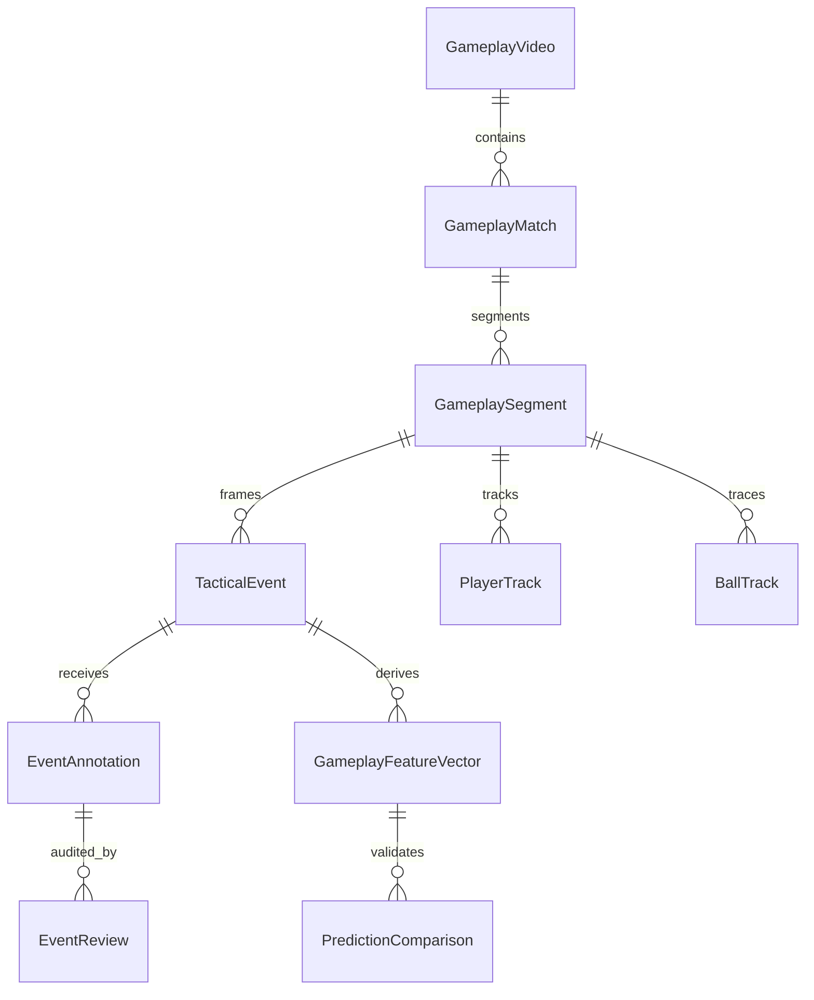

# Phase 36 Gameplay Feature Store Schema
**Project:** EA FC Intelligence — Stadium 3.0  
**Phase:** 36 — Video Gameplay Intelligence & Empirical Validation  
**Date:** November 24, 2026  
**Standard:** Relational & Feature Store Architecture  

---

## 1. Feature Store Architecture

The Gameplay Feature Store structures raw video telemetry into analytical feature vectors suitable for testing against V3.2.1 deterministic predictions:

---

## 2. Entity Specifications

### 2.1 `GameplayVideo`
- `video_id` (UUID, Primary Key)
- `source_url` (VARCHAR(512), Unique)
- `platform` (ENUM: `YOUTUBE`, `LOCAL_STORAGE`, `DIRECT_FEED`)
- `title` (VARCHAR(256))
- `creator_name` (VARCHAR(128))
- `publication_date` (DATE)
- `game_version` (VARCHAR(16), e.g. `FC27`)
- `game_patch` (VARCHAR(32), e.g. `PATCH_1.02`)
- `video_type` (ENUM: `FULL_MATCH`, `EDITED_MATCH`, `CARD_REVIEW`, `TACTICAL_TUTORIAL`, `CONTROLLED_COMPARISON`)
- `duration_seconds` (FLOAT)
- `rights_status` (ENUM: `PUBLIC_EMBED_ONLY`, `AUTHORIZED_LOCAL_ANALYSIS`, `PROJECT_OWNED`)
- `review_status` (ENUM: `DRAFT`, `REGISTERED`, `VERIFIED`, `REJECTED`)

### 2.2 `TacticalEvent`
- `event_id` (UUID, Primary Key)
- `video_id` (UUID, Foreign Key)
- `match_id` (UUID, Foreign Key)
- `timestamp_start` (FLOAT, seconds from video start)
- `timestamp_end` (FLOAT, seconds from video start)
- `event_type` (VARCHAR(64), matching Taxonomy)
- `team_identity` (ENUM: `HOME`, `AWAY`, `NEUTRAL`)
- `player_identity` (VARCHAR(128), optional name)
- `card_item_id` (UUID, optional link to UT card)
- `formation` (VARCHAR(16), e.g. `4-3-3`)
- `formation_slot` (VARCHAR(8), e.g. `ST`)
- `tactical_context` (VARCHAR(32), e.g. `HIGH_PRESS`, `COUNTER_ATTACK`)
- `pitch_zone` (INTEGER, 1 to 18)
- `observed_action` (TEXT)
- `observed_outcome` (VARCHAR(64))
- `observation_method` (ENUM: `MANUAL_ANNOTATION`, `CV_ASSISTED`, `AUTOMATED_DETECTOR`)
- `identity_confidence` (ENUM: `HIGH`, `PROVISIONAL`, `UNRESOLVED`)
- `review_status` (ENUM: `DRAFT`, `SUBMITTED`, `UNDER_REVIEW`, `ACCEPTED`, `REJECTED`)
- `related_hypothesis` (VARCHAR(64), e.g. `HYP-RULE-HP-FWD-DEF`)

### 2.3 `PlayerTrack` (For Authorized Assets)
- `track_id` (UUID, Primary Key)
- `segment_id` (UUID, Foreign Key)
- `player_slot` (VARCHAR(8))
- `frame_index` (INTEGER)
- `timestamp` (FLOAT)
- `bounding_box` (JSON: `[x, y, w, h]`)
- `pitch_coordinates` (JSON: `[x_m, y_m]`, metric pitch coordinates)
- `velocity_mps` (FLOAT, meters per second)
- `track_confidence` (FLOAT, 0.0 to 1.0)
- `is_occluded` (BOOLEAN)

### 2.4 `GameplayFeatureVector` (Aggregated Analysis)
- `vector_id` (UUID, Primary Key)
- `card_item_id` (UUID, Foreign Key)
- `tactical_context` (VARCHAR(32))
- `sample_minutes` (FLOAT)
- `tackles_per_90` (FLOAT)
- `interceptions_per_90` (FLOAT)
- `turnovers_forced_per_90` (FLOAT)
- `progressive_passes_per_90` (FLOAT)
- `counterattack_involvements_per_90` (FLOAT)
- `average_press_distance_m` (FLOAT)
- `quality_tier` (ENUM: `TIER_A`, `TIER_B`, `TIER_C`, `TIER_D`)
