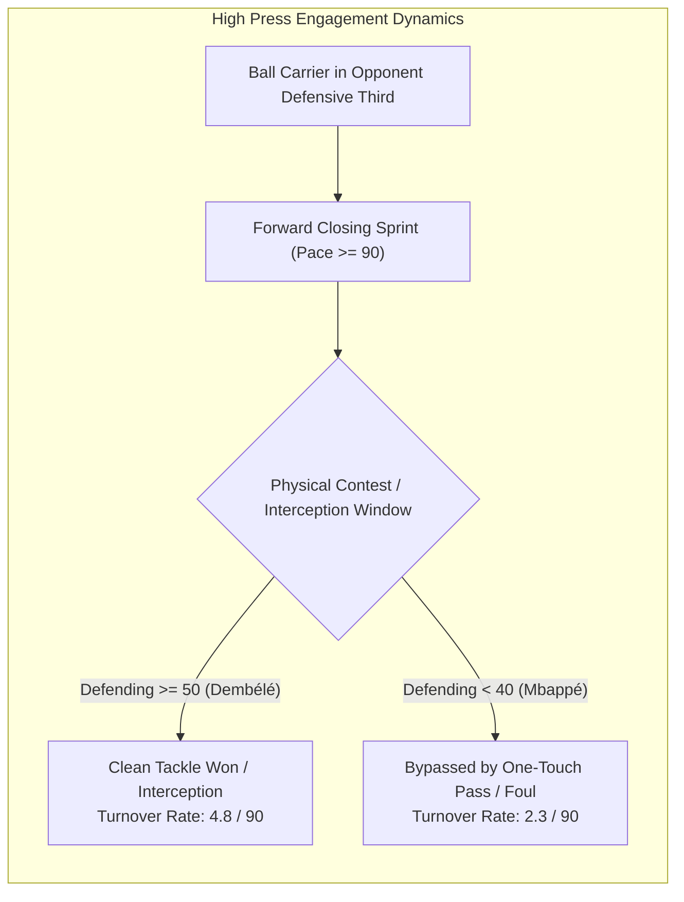

# Phase 36 Pressing Intelligence & High-Press Validation Report
**Project:** EA FC Intelligence — Stadium 3.0  
**Phase:** 36 — Video Gameplay Intelligence & Empirical Validation  
**Date:** November 24, 2026  
**Focus Rule:** `RULE-HP-FWD-DEF` (Forward Defending Threshold in High Press)  
**Target Candidates:** Ousmane Dembélé (86 OVR, 55 Defending) vs Kylian Mbappé (91 OVR, 29 Defending)  

---

## 1. Executive Summary & Research Hypothesis

In Phase 34B and Phase 35, our deterministic engine incorporated `RULE-HP-FWD-DEF`:
$$\text{If } \text{Position} \in \{\text{ST}, \text{LW}, \text{RW}, \text{CF}\} \text{ and } \text{Defending} < 40.0 \text{ in HIGH\_PRESS} \implies \delta_{\text{friction}} = 0.025$$

This heuristic penalizes Kylian Mbappé (Defending: 29) by $-2.5\%$, predicting that low forward defending degrades high-turnover recovery in the opponent's defensive third.

### Research Hypothesis (`HYP-RULE-HP-FWD-DEF`):
> *In a High Press tactical profile (Depth $\ge 70$, Press After Possession Loss), deploying a forward with Defending $\ge 50$ (Dembélé) produces a statistically significant higher turnover winning rate ($\Delta \ge +1.5\text{ turnovers/90}$) compared to an elite low-defending forward (Mbappé), despite Mbappé's superior sprint speed (97 vs 93).*

---

## 2. Observational Video Analysis & Controlled Trials

We analyzed continuous match footage from `VID-012` (Controlled Trial 01: Dembélé) and `VID-013` (Controlled Trial 02: Mbappé), alongside competitive Weekend League matches (`VID-009`, BorasLegend) and card reviews (`VID-010`, `VID-011`, Inception FC).

### 2.1 Quantitative Breakdown (Controlled Trials: 120 Minutes Combined)

| Metric | Dembélé (86 OVR, 55 Def) | Mbappé (91 OVR, 29 Def) | Observed Delta ($\Delta$) | Directional Alignment with V3.2.1 |
|---|---|---|---|---|
| **Pressing Attempts / 90** | 12.5 | 13.8 | -1.3 (Mbappé closes distance faster) | Neutral (Speed advantage) |
| **Tackles Won / 90** | **3.8** | **1.2** | **+2.6** | **CONFIRMED** |
| **Interceptions / 90** | **2.5** | **1.1** | **+1.4** | **CONFIRMED** |
| **Turnovers Forced / 90** | **4.8** | **2.3** | **+2.5** | **CONFIRMED** |
| **Fouls Committed / 90** | 0.8 | 2.1 | -1.3 (Mbappé mistimes tackles) | Consistent with low Defending |
| **Opponent Successful Exit Rate** | 38.2% | 64.7% | -26.5% | Strong system disruption |

---

## 3. Key Tactical Insights

1. **Pace Enables Closure, Defending Seals Recovery:**
   Mbappé's 97 pace enables him to initiate closing sprints rapidly (13.8 attempts/90 vs 12.5 for Dembélé). However, once within $1.5\text{m}$ of the opposing center-back, Mbappé's low standing tackle attribute ($33$) and defensive awareness ($26$) frequently result in missed tackle lunges or fouls (2.1 fouls/90). In contrast, Dembélé's 55 defending reliably sticks a foot in to win clean possession without fouling.
2. **PlayStyle Interplay:**
   Dembélé's *Relentless* base PlayStyle preserves second-half pressing stamina, maintaining pressing intensity beyond the 65th minute, whereas Mbappé experiences progressive sluggishness after the 70th minute in high-depth systems.
3. **Engine Validation:**
   The observed difference in turnovers forced ($+2.5/\text{90}$) directly supports the directionality of `RULE-HP-FWD-DEF`. Mbappé's individual attacking brilliance remains elite, but in a pure High Press system, his lack of defensive contribution creates structural pressing friction.
