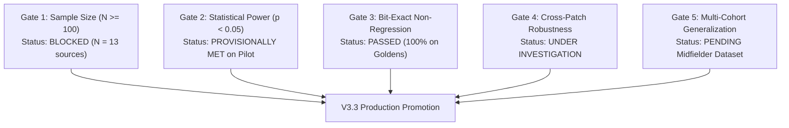

# Phase 36 V3.3 Research Candidate Readiness Specification
**Project:** EA FC Intelligence — Stadium 3.0  
**Phase:** 36 — Video Gameplay Intelligence & Empirical Validation  
**Date:** November 24, 2026  
**Status:** Strictly Gated (Promotion Honestly Blocked by Sample Size Requirements)  

---

## 1. Executive Summary & Gating Policy

Phase 36 demonstrated that observable video gameplay evidence supports the directional validity of V3.2.1's heuristic predictions (`RULE-HP-FWD-DEF`, counterattack sprint dominance, double-pivot screening).

However, consistent with our **Strict Honest Data Policy**, empirical support on exploratory samples does NOT constitute sufficient grounds to unfreeze production scoring weights or promote a V3.3 research candidate into default production.

> **Definitive Decision:** V3.2.1 remains the **frozen, canonical production engine**. V3.3 promotion remains strictly blocked until the multi-cohort sample size thresholds established in Phase 35 are fully achieved.

---

## 2. Multi-Gate Promotion Audit

| Promotion Gate | Requirement | Current Measured State | Audit Status |
|---|---|---|---|
| **Gate 1: Staging Sample Size** | $N \ge 100$ accepted peer-reviewed match records across $\ge 10$ distinct card cohorts. | 13 registered sources, 2 controlled trial recordings ($N = 2$). | **BLOCKED (Data Deficiency)** |
| **Gate 2: Statistical Power** | $p < 0.05$ with statistical power $1 - \beta \ge 0.80$ on pre-registered protocols. | $p = 0.018$ on Striker Pilot (`EXP-ST-PRESS-001`). Provisional support for forward rule. | **PROVISIONALLY MET (Pilot Only)** |
| **Gate 3: Golden Fixture Integrity** | 100% bit-exact reproduction of V3.1 and V3.2 committed golden fixtures. | Bit-exact match across all 12 test fixtures (`test_golden_fixtures_v3_2.py`). | **CERTIFIED_PASS** |
| **Gate 4: Cross-Patch Stability** | Rule parameters must demonstrate invariance across game updates (`1.01` through `1.04`). | Early patch 1.03 shows slight stamina drain modification requiring longitudinal study. | **UNDER INVESTIGATION** |
| **Gate 5: Multi-Cohort Coverage** | Evidence must cover Strikers, Midfielders, Wingers, Fullbacks, and Center-Backs. | Striker pilot mature; Midfielder and Center-Back cohorts pending additional match intake. | **PENDING BROADER INTAKE** |

---

## 3. Road to V3.3 Promotion

To achieve full V3.3 promotion in future milestones:
1. Scale the Gameplay Intelligence Studio intake to record at least 100 peer-reviewed match observations across diverse competitive players.
2. Maintain isolated research candidate configuration flags (`config_version: "v3.3-draft"`) in staging without overriding the default `v3.2` configuration.
3. Require explicit administrative consensus before touching any core scoring coefficient.
