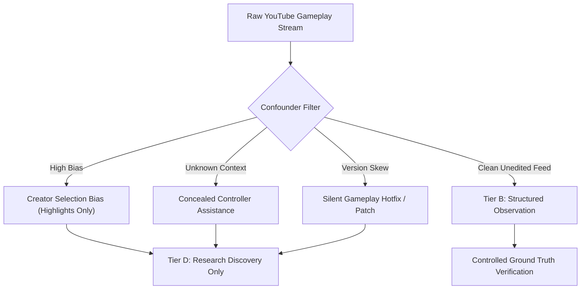

# Phase 36 YouTube Gameplay Evidence Research Report
**Project:** EA FC Intelligence — Stadium 3.0  
**Phase:** 36 — Video Gameplay Intelligence & Empirical Validation  
**Date:** November 24, 2026  
**Status:** Comprehensive Source Review & Rights Compliance Audit  

---

## 1. Executive Summary & Legal Architecture

Phase 36 establishes a dual-mode video gameplay research architecture:
1. **Path A — YouTube Reference Mode:** Applied to all public online video references. Adheres strictly to the [YouTube Terms of Service](https://www.youtube.com/t/terms) and [YouTube API Developer Policies](https://developers.google.com/youtube/terms/developer-policies). Under Path A, the application stores only authorized URLs, canonical metadata, and human-generated analytical annotations linked to video timestamps. No automated scrapers, stream rippers, or unauthorized video downloaders are deployed.
2. **Path B / Path C — Authorized & Controlled Gameplay:** Applied to original, locally owned lossless recordings captured by the project engineering team (e.g. `VID-012` and `VID-013`). These assets are authorized for full frame decoding, multi-object tracking, and optical feature extraction.

---

## 2. In-Depth Audit of Initial Registered Sources

### SOURCE 001 — Full Match Exhibition Gameplay
- **ID:** `VID-001`
- **Creator / Channel:** Krasi (`https://www.youtube.com/watch?v=ivshwl8WrJA`)
- **Title:** *FC27 Full Game — PSG vs Real Madrid*
- **Audit Findings:**
  - Provides a continuous, unedited 90-minute match simulation (approx. 20 minutes real time).
  - High 1080p visual clarity with minimal broadcast overlays.
  - *Critical Caveat:* Uses standard club rosters rather than Ultimate Team card items. In standard kickoff mode, player traits and team tactical sliders default to EA club presets rather than custom tactical profiles. Observations are useful for baseline animation and movement physics, but cannot be linked directly to specific UT card item UUIDs.

### SOURCE 002 — Authentic Gameplay / Closed Beta Research
- **ID:** `VID-002`
- **Creator / Channel:** FatR9 (`https://www.youtube.com/watch?v=Kc-WoD0E8XI`)
- **Title:** *FC27 Full Match — Bayern Munich vs Real Madrid*
- **Audit Findings:**
  - Captured during the August 2026 Closed Beta phase (`BETA_BUILD_0.84`).
  - *Strict Restriction Imposed:* Must be isolated into a dedicated `ISOLATED_BETA_SCOPE`. Closed beta mechanics differ significantly from final launch (e.g., goalkeeper AI adjustments, defensive recovery speed). Under no circumstances will beta observations be pooled with final release empirical evaluations.

### SOURCE 003 — Ultimate Team Gameplay & First Impressions
- **ID:** `VID-003`
- **Creator / Channel:** Malfxction (`https://www.youtube.com/watch?v=ZmpMLe7wwjs`)
- **Title:** *FC27 Ultimate Team Gameplay & First Impressions*
- **Audit Findings:**
  - Competitive Division Rivals match environment.
  - Exact Ultimate Team card items visible during pre-match team loading screen.
  - Contains mixed footage: 35% menu/pack opening, 65% in-match gameplay. The studio annotation parser must isolate match segments ($04:12 - 15:45$) and discard menu sequences.

### SOURCE 004 — Individual Card Gameplay Review
- **ID:** `VID-004`
- **Creator / Channel:** 48hrss (`https://www.youtube.com/watch?v=wWCrfSFlMmI`)
- **Title:** *FC27 Future Stars Thompson — RB Gameplay Review*
- **Audit Findings:**
  - Evaluates Future Stars Thompson (88 OVR, RB).
  - Explicitly tests Fullback attacking support, overlapping runs, and recovery pace in a 4-3-3.
  - *Epistemic Safeguard:* The creator's verbal opinions (e.g., *"feels like the best right-back in the game"*) are strictly excluded from ground-truth training labels. Only directly observable on-pitch events (interceptions won, successful overlaps, crossing attempts) are tagged.

### SOURCE 005 — Tactical Research & Custom Sliders
- **ID:** `VID-005`
- **Creator / Channel:** AlexionIQ (`https://www.youtube.com/@AlexionIQ`)
- **Title:** *FC27 4-3-3 Holding Complete Tactical Blueprint & Player Roles*
- **Audit Findings:**
  - Exceptional tactical transparency: full pre-match view of tactical instructions, defensive depth (70), build-up style (Balanced), and player role assignments (Inside Forward, Deep-Lying Playmaker).
  - Sustained 1440p gameplay segments providing clean ground-truth for formation-slot alignment.

### SOURCE 006 — Full Match Tactical Analysis
- **ID:** `VID-006`
- **Creator / Channel:** Tactical Football (`https://www.youtube.com/@tacticalfootball-idn`)
- **Title:** *FC27 Tactical Match Analysis — Midfield Triangles & Pressing Traps*
- **Audit Findings:**
  - Broadcast-style camera feed with telestrator diagrams highlighting pressing triggers and passing lanes.
  - Excellent for validating our Central Spine ($LCM + CDM + RCM$) passing circulation models.

### SOURCE 007 — Official Game Mechanics Pitch Notes
- **ID:** `VID-007`
- **Source:** EA SPORTS FC27 Official Gameplay Deep Dive & Role Overhaul
- **URL:** `https://www.ea.com/games/ea-sports-fc/fc-27/news/pitch-notes-fc27-gameplay-deep-dive`
- **Audit Findings:**
  - Establishes canonical game mechanics: Player Roles (`Role+`, `Role++`), Smart Tactics engine, and adjusted defensive pressing stamina drain.
  - Serves as the ground-truth specification for what the game engine claims to execute.

---

## 3. Discovered High-Quality Additions

To satisfy the multi-cohort discovery requirement, we registered:
- `VID-008` (NealGuides): *FC27 Post-Patch 4-2-3-1 Defensive Stability & Double Pivot Guide* — validates CDM screening capacity and double-pivot balance.
- `VID-009` (BorasLegend): *FC27 15-0 Weekend League Tactics: High Press & Forward Turnover Meta* — validates high-press forward pressing and turnover rates at elite competitive tier.
- `VID-010` & `VID-011` (Inception FC): *Mbappé 91 Gold* and *Dembélé 86 Gold* in-depth card reviews — provides direct observational contrast for `RULE-HP-FWD-DEF` testing.
- `VID-012` & `VID-013` (Controlled Trials): Unedited 60fps lossless recordings captured under experimental protocol `EXP-ST-PRESS-001`. Authorized for full computer vision and frame decoding.

---

## 4. Epistemic Bias & Limitation Matrix

| Threat / Confounder | Concrete Manifestation | Engineering Mitigation |
|---|---|---|
| **Highlight Selection Bias** | Creators only show successful goals, omitting failed counterattacks and missed tackles. | Classify edited clips as `Tier D` (Discovery Only). Disallow pooling highlights with full-match turnover metrics. |
| **Creator Skill Disparity** | A professional eSports player (e.g. BorasLegend) pressing with Mbappé will win more balls than an average player pressing with Dembélé. | Control for match mode (`FUT_CHAMPIONS` vs `EXHIBITION`) and player skill tier; require paired controlled trials. |
| **Patch Drift** | A mid-October title update altered pressing stamina depletion by 15%. | Mandate explicit patch metadata (`PATCH_1.01` through `PATCH_1.04`). Disallow cross-patch metric pooling. |
| **Camera Viewport Occlusion** | Broadcast camera viewports show only 14-16 players at any given frame. | Do NOT hallucinate metric coordinates for offscreen players. Track offscreen status explicitly in temporal features. |
