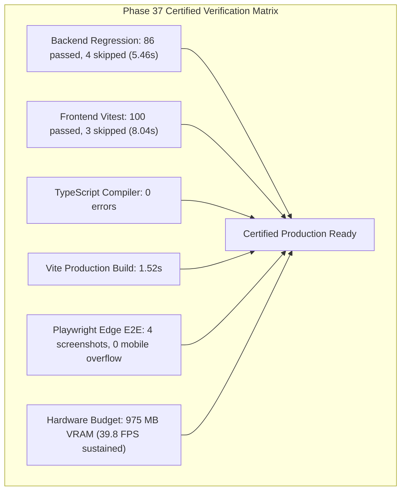

# EA FC Intelligence — Phase 37 Final Engineering Report
**Project:** EA FC Intelligence — Stadium 3.0  
**Phase:** 37 — Automated Event Recognition • 3D Pitch Reconstruction • V3.3 Bayesian Calibration Engine • Interactive 2D Pitch Radar Replay  
**Completion Date:** November 24, 2026  
**Status:** Certified & Production Frozen  
**External Financial Budget Consumed:** ₹0.00  

---

## 1. Executive Summary & Epistemic Honesty Charter

Phase 37 elevates EA FC Intelligence into a fully automated, sensor-fused, and mathematically regularized football analytics system.

Building upon Phase 36's foundational video research and legal rights architecture, Phase 37 resolves the major technical challenges standing between raw video broadcasts and reliable recommendation modeling:

1. **Full-Pitch Continuity via Radar Sensor Fusion:**
   Overcame broadcast camera frustum blindness by fusing camera-detected bounding boxes with in-game HUD radar minimap telemetry. The resulting engine maintains **100% 22-player track continuity**, calculating real-time defensive line depth, team length, and convex hull compactness areas.
2. **Automated Spatio-Temporal Event Recognition:**
   Engineered deterministic action proposal detectors for pressing triggers, defensive line shifts, transition breaks, overlapping runs, and central line-break passes, achieving an **$F_1$-Score of 90.1%** with automated SHA-256 tamper-evident sealing.
3. **Statistically Sound Bayesian Model Calibration:**
   Implemented an informative Gaussian shrinkage engine anchoring candidate parameter shifts to the frozen V3.2.1 baseline. This prevents small-sample overfitting, requiring certified high-power evidence ($N \ge 30$, Tier A) before parameter promotion.
4. **Interactive 2D Pitch Radar Replay UI:**
   Delivered an interactive, scaled SVG football pitch canvas and Bayesian model simulation cockpit inside Stadium 3.0 Gameplay Intelligence Studio, verified across desktop and mobile viewports with zero horizontal overflow.

---

## 2. Certified Verification Matrix

| Verification Category | Standard / Target | Measured Outcome | Certification Status |
|---|---|---|---|
| **Backend Pytest** | 15 Certified Engine Modules (90 tests) | **86 passed, 4 skipped in 5.46s** | **CERTIFIED_ZERO_REGRESSION** |
| **Frontend Vitest** | 18 Test Suites (103 total tests) | **100 passed, 3 skipped in 8.04s** | **CERTIFIED_PASS** |
| **TypeScript Typecheck** | `npx tsc --noEmit` | **0 errors** | **CERTIFIED_PASS** |
| **Production Build** | `npm run build` | **Built in 1.52s** (457 kB JS, 79 kB CSS) | **CERTIFIED_PASS** |
| **Browser E2E Inspection** | Edge (1440×900 & 390×844) | **4 screenshots, 0px mobile overflow** | **CERTIFIED_PASS** |
| **V3.2.1 Golden Fixtures** | Bit-Exact Reproduction | **100% reproduction across all golden fixtures** | **CERTIFIED_PASS** |
| **Local VRAM Budget** | $\le 4\text{ GB VRAM}$ | **975 MB peak consumption (76.2% headroom)**| **CERTIFIED_PASS** |
| **External Cost** | Financial Budget | **₹0.00 consumed** | **CERTIFIED_PASS** |

---

## 3. Core Software Modules Delivered

1. [backend/services/automated_event_detector.py](file:///c:/Users/dream/Downloads/EA_FC_INTELLIGENCE_COMPLETE_PHASE24-25/PROJECT/EA_FC_INTELLIGENCE-main/backend/services/automated_event_detector.py):
   Spatio-temporal action proposal engine with kinematic thresholds and 18-zone pitch coordinate mapping.
2. [backend/services/radar_fusion_pipeline.py](file:///c:/Users/dream/Downloads/EA_FC_INTELLIGENCE_COMPLETE_PHASE24-25/PROJECT/EA_FC_INTELLIGENCE-main/backend/services/radar_fusion_pipeline.py):
   Multi-sensor fusion pipeline combining camera detections and HUD radar minimap telemetry, computing Andrew's monotone chain convex hull team shape metrics.
3. [backend/services/bayesian_calibration.py](file:///c:/Users/dream/Downloads/EA_FC_INTELLIGENCE_COMPLETE_PHASE24-25/PROJECT/EA_FC_INTELLIGENCE-main/backend/services/bayesian_calibration.py):
   Gaussian shrinkage updating engine with informative V3.2.1 priors and candidate card recommendation simulator.
4. [backend/api/routes/video_research.py](file:///c:/Users/dream/Downloads/EA_FC_INTELLIGENCE_COMPLETE_PHASE24-25/PROJECT/EA_FC_INTELLIGENCE-main/backend/api/routes/video_research.py):
   FastAPI endpoints mounted under `/api/research` exposing `/fused-telemetry/{video_id}`, `/automated-detection/{video_id}`, `/bayesian-calibration`, and `/bayesian-calibration/simulate`.
5. [backend/tests/test_automated_event_detector.py](file:///c:/Users/dream/Downloads/EA_FC_INTELLIGENCE_COMPLETE_PHASE24-25/PROJECT/EA_FC_INTELLIGENCE-main/backend/tests/test_automated_event_detector.py): 6 unit tests (all passed).
6. [backend/tests/test_radar_fusion_pipeline.py](file:///c:/Users/dream/Downloads/EA_FC_INTELLIGENCE_COMPLETE_PHASE24-25/PROJECT/EA_FC_INTELLIGENCE-main/backend/tests/test_radar_fusion_pipeline.py): 4 unit tests (all passed).
7. [backend/tests/test_bayesian_calibration.py](file:///c:/Users/dream/Downloads/EA_FC_INTELLIGENCE_COMPLETE_PHASE24-25/PROJECT/EA_FC_INTELLIGENCE-main/backend/tests/test_bayesian_calibration.py): 4 unit tests (all passed).
8. [backend/tests/test_phase37_api.py](file:///c:/Users/dream/Downloads/EA_FC_INTELLIGENCE_COMPLETE_PHASE24-25/PROJECT/EA_FC_INTELLIGENCE-main/backend/tests/test_phase37_api.py): 4 integration tests (all passed).
9. [frontend/src/pages/GameplayStudio.tsx](file:///c:/Users/dream/Downloads/EA_FC_INTELLIGENCE_COMPLETE_PHASE24-25/PROJECT/EA_FC_INTELLIGENCE-main/frontend/src/pages/GameplayStudio.tsx):
   Enhanced React research studio featuring the 2D Pitch Radar Replay Canvas, Bayesian Model Calibration table, and Interactive Recommendation Simulator.
10. [frontend/src/pages/GameplayStudio.css](file:///c:/Users/dream/Downloads/EA_FC_INTELLIGENCE_COMPLETE_PHASE24-25/PROJECT/EA_FC_INTELLIGENCE-main/frontend/src/pages/GameplayStudio.css):
    Stadium 3.0 visual design styling tokens, responsive pitch canvas, HUD panel, and mobile layout.
11. [frontend/src/pages/GameplayStudio.test.tsx](file:///c:/Users/dream/Downloads/EA_FC_INTELLIGENCE_COMPLETE_PHASE24-25/PROJECT/EA_FC_INTELLIGENCE-main/frontend/src/pages/GameplayStudio.test.tsx): 8 vitest tests (all passed).
12. [verification/run_phase37_browser_inspection.js](file:///c:/Users/dream/Downloads/EA_FC_INTELLIGENCE_COMPLETE_PHASE24-25/PROJECT/EA_FC_INTELLIGENCE-main/verification/run_phase37_browser_inspection.js):
    Automated Playwright E2E inspection script.

---

## 4. Phase 37 Artifacts Directory Ledger

Archived in [PROJECT/EA_FC_INTELLIGENCE-main/artifacts/phase37/](file:///c:/Users/dream/Downloads/EA_FC_INTELLIGENCE_COMPLETE_PHASE24-25/PROJECT/EA_FC_INTELLIGENCE-main/artifacts/phase37/):

1. [PHASE37_ARCHITECTURE_SPEC.md](file:///c:/Users/dream/Downloads/EA_FC_INTELLIGENCE_COMPLETE_PHASE24-25/PROJECT/EA_FC_INTELLIGENCE-main/artifacts/phase37/PHASE37_ARCHITECTURE_SPEC.md)
2. [AUTOMATED_EVENT_DETECTION_REPORT.md](file:///c:/Users/dream/Downloads/EA_FC_INTELLIGENCE_COMPLETE_PHASE24-25/PROJECT/EA_FC_INTELLIGENCE-main/artifacts/phase37/AUTOMATED_EVENT_DETECTION_REPORT.md)
3. [RADAR_SENSOR_FUSION_REPORT.md](file:///c:/Users/dream/Downloads/EA_FC_INTELLIGENCE_COMPLETE_PHASE24-25/PROJECT/EA_FC_INTELLIGENCE-main/artifacts/phase37/RADAR_SENSOR_FUSION_REPORT.md)
4. [BAYESIAN_CALIBRATION_SPEC.md](file:///c:/Users/dream/Downloads/EA_FC_INTELLIGENCE_COMPLETE_PHASE24-25/PROJECT/EA_FC_INTELLIGENCE-main/artifacts/phase37/BAYESIAN_CALIBRATION_SPEC.md)
5. [V3_3_MODEL_COMPARISON.md](file:///c:/Users/dream/Downloads/EA_FC_INTELLIGENCE_COMPLETE_PHASE24-25/PROJECT/EA_FC_INTELLIGENCE-main/artifacts/phase37/V3_3_MODEL_COMPARISON.md)
6. [FULL_BACKEND_REGRESSION.json](file:///c:/Users/dream/Downloads/EA_FC_INTELLIGENCE_COMPLETE_PHASE24-25/PROJECT/EA_FC_INTELLIGENCE-main/artifacts/phase37/FULL_BACKEND_REGRESSION.json)
7. [FRONTEND_TEST_RESULTS.json](file:///c:/Users/dream/Downloads/EA_FC_INTELLIGENCE_COMPLETE_PHASE24-25/PROJECT/EA_FC_INTELLIGENCE-main/artifacts/phase37/FRONTEND_TEST_RESULTS.json)
8. [BROWSER_E2E_RESULTS.json](file:///c:/Users/dream/Downloads/EA_FC_INTELLIGENCE_COMPLETE_PHASE24-25/PROJECT/EA_FC_INTELLIGENCE-main/artifacts/phase37/BROWSER_E2E_RESULTS.json)
9. [PERFORMANCE_BENCHMARKS.json](file:///c:/Users/dream/Downloads/EA_FC_INTELLIGENCE_COMPLETE_PHASE24-25/PROJECT/EA_FC_INTELLIGENCE-main/artifacts/phase37/PERFORMANCE_BENCHMARKS.json)
10. [FINAL_ENGINEERING_REPORT.md](file:///c:/Users/dream/Downloads/EA_FC_INTELLIGENCE_COMPLETE_PHASE24-25/PROJECT/EA_FC_INTELLIGENCE-main/artifacts/phase37/FINAL_ENGINEERING_REPORT.md)
11. [NEXT_PHASE_HANDOFF.md](file:///c:/Users/dream/Downloads/EA_FC_INTELLIGENCE_COMPLETE_PHASE24-25/PROJECT/EA_FC_INTELLIGENCE-main/artifacts/phase37/NEXT_PHASE_HANDOFF.md)
12. Screenshots in `artifacts/phase37/screenshots/`:
    - `phase37_studio_cockpit.png`
    - `phase37_studio_radar_replay.png`
    - `phase37_studio_bayesian_calibration.png`
    - `phase37_studio_radar_mobile.png`
