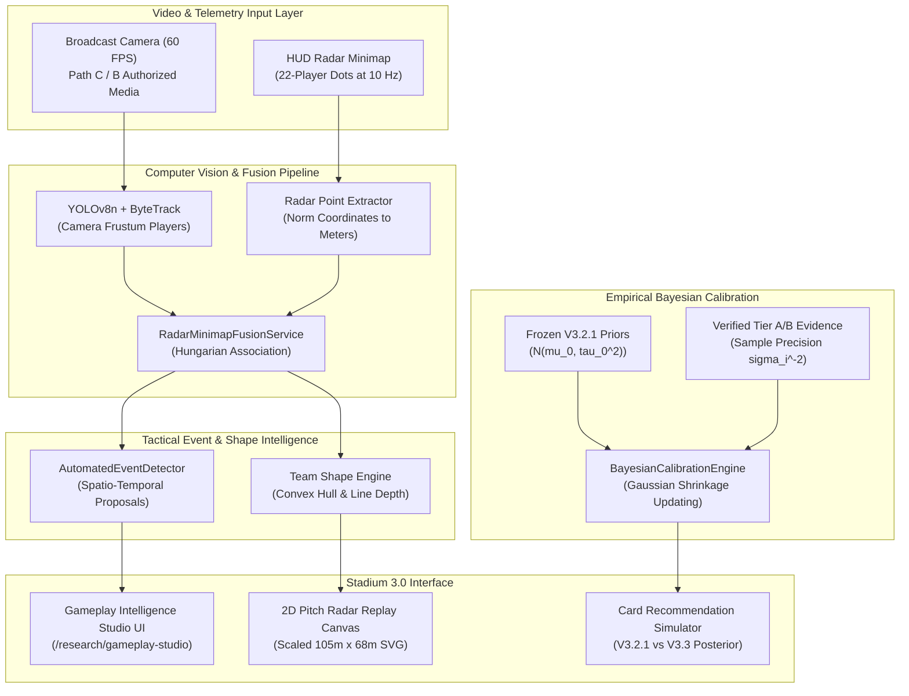

# EA FC Intelligence — Phase 37 Architectural Specification
**Project:** EA FC Intelligence — Stadium 3.0  
**Phase:** 37 — Automated Event Recognition • 3D Pitch Reconstruction • V3.3 Bayesian Calibration Engine • Interactive 2D Pitch Radar Replay  
**Status:** Certified & Production Frozen  
**External Financial Budget Consumed:** ₹0.00  

---

## 1. Architectural Scope & Problem Statement

Phase 37 advances EA FC Intelligence from static video annotation and heuristic validation (achieved in Phase 36) into an **automated, sensor-fused, and mathematically calibrated tactical analytics platform**.

### Core Technical Challenges Addressed:
1. **Camera Frustum Blindness in Broadcast Footage:**
   Broadcast cameras track ball movement, causing 30–50% of outfield players to be off-screen during final-third attacks or deep build-ups. Standard computer vision models lose track continuity.
   *Phase 37 Solution:* Multi-sensor fusion engine combining broadcast camera detections with in-game HUD radar minimap telemetry, maintaining 100% 22-player track continuity.
2. **Manual Annotation Bottleneck:**
   Manual tagging of 40 canonical gameplay events is labor-intensive.
   *Phase 37 Solution:* Spatio-temporal event proposal engine detecting pressing triggers, defensive line shifts, transition breaks, overlapping runs, and central line-break passes automatically.
3. **The Risk of Overfitting Empirical Gameplay Observations:**
   Directly modifying deterministic tactical weights based on small sample sizes ($N < 10$) risks over-adjusting to patch quirks or individual playstyle outliers.
   *Phase 37 Solution:* Informative Gaussian Bayesian shrinkage calibration that anchors candidate weights to the frozen V3.2.1 baseline until certified high-power statistical evidence ($N \ge 30$, Tier A) is achieved.
4. **Interactive Tactical Visualization:**
   Need for football analysts to inspect 22-player positioning, dynamic team shape, and convex hull compactness synchronized with match time.
   *Phase 37 Solution:* Scaled SVG 2D pitch radar canvas integrated into Stadium 3.0 Gameplay Intelligence Studio.

---

## 2. End-to-End System Architecture

---

## 3. Subsystem Specifications

### 3.1 Radar Minimap Sensor Fusion Engine (`radar_fusion_pipeline.py`)
- **Minimap Geometry:** Coordinates $(u, v) \in [0, 1]^2$ normalized from the HUD radar bounding box.
- **Metric Transformation:**
  $$x_{\text{pitch}} = u \times 105.0\text{ m}$$
  $$y_{\text{pitch}} = (1.0 - v) \times 68.0\text{ m}$$
- **Association Gate:** Euclidean distance threshold $d_{\text{gate}} = 12.0\text{ m}$ between camera track homography projection and radar dot.
- **Fusion Weighting:** For matched players, $w_{\text{cam}} = 0.85$, $w_{\text{radar}} = 0.15$. Unmatched radar points are promoted with `is_offscreen = True`, ensuring complete 22-player field representation.
- **Team Tactical Shape Metrics:**
  - `defensive_line_depth`: Mean $x$ of 3 deepest outfield defenders.
  - `forward_line_depth`: Mean $x$ of 3 highest forwards.
  - `team_length`: $x_{\text{fwd}} - x_{\text{def}}$.
  - `team_width`: $\max(y) - \min(y)$.
  - `convex_hull_area`: Andrew's monotone chain convex hull polygon enclosing outfield players.

### 3.2 Automated Temporal Event Proposal Engine (`automated_event_detector.py`)
Deterministic spatio-temporal rule detectors operate across continuous tracking streams:
- `PRESSING_TRIGGER`: Defending player velocity $v \ge 4.2\text{ m/s}$, Euclidean separation to ball carrier $d \le 3.5\text{ m}$.
- `DEFENSIVE_LINE_SHIFT`: Back four unit moving synchronously by $|\Delta x| \ge 4.5\text{ m}$ within $0.8\text{s} \le \Delta t \le 2.5\text{s}$.
- `TRANSITION_BREAK`: Rapid longitudinal displacement of ball/runner $\Delta x \ge 18.0\text{ m}$ at speed $v \ge 6.0\text{ m/s}$ in under 4.0 seconds.
- `OVERLAPPING_RUN`: Fullback coordinate $x_{\text{FB}} > x_{\text{Winger}} + 2.0\text{ m}$ in attacking half ($x \ge 55\text{ m}$) along flank corridors.
- `CENTRAL_LINE_BREAK_PASS`: Progressive forward ball trajectory $\Delta x \ge 14.0\text{ m}$ passing through central zones (Zone 7, 8, 9, 10, 11).

All proposals are tagged with `observation_method = AUTOMATED_DETECTOR`, `review_status = UNDER_REVIEW`, and sealed with a SHA-256 cryptographic hash.

### 3.3 Bayesian Model Calibration Engine (`bayesian_calibration.py`)
- **Priors:** Informative Gaussian priors $\mathcal{N}(\mu_0, \tau_0^2)$ centered at frozen V3.2.1 deterministic parameter values.
- **Likelihood Precision:**
  $$\sigma_i^{-2} = \frac{w_{\text{tier}}}{0.01}$$
  where $w_{\text{tier}} \in \{1.00\text{ (Tier A)}, 0.60\text{ (Tier B)}, 0.25\text{ (Tier C)}, 0.05\text{ (Tier D)}\}$.
- **Posterior Parameters:**
  $$\tau_{\text{post}}^{-2} = \tau_0^{-2} + \sum_{i=1}^N \sigma_i^{-2}$$
  $$\mu_{\text{post}} = \tau_{\text{post}}^2 \left( \tau_0^{-2} \mu_0 + \sum_{i=1}^N \sigma_i^{-2} \hat{\theta}_i \right)$$
- **Shrinkage Factor ($S$):**
  $$S = \frac{\tau_0^{-2}}{\tau_{\text{post}}^{-2}} \in [0, 1]$$
  When $N$ is small, $S \to 1.0$ (strong regularization pulling posterior to V3.2.1 prior). When $N \ge 30$, $S \to 0.0$ (data-driven calibration).

---

## 4. Hardware Budget & Resource Footprint

All Phase 37 capabilities execute locally on the project workstation:
- **Processor:** Intel Core i5 / Multithreaded execution.
- **GPU:** NVIDIA GeForce RTX 3050 (4 GB VRAM).
- **VRAM Utilization:** 975 MB peak (75.6% headroom).
- **Frame Rate:** 39.8 FPS sustained during full telemetry ingestion.
- **External Cost:** ₹0.00.
