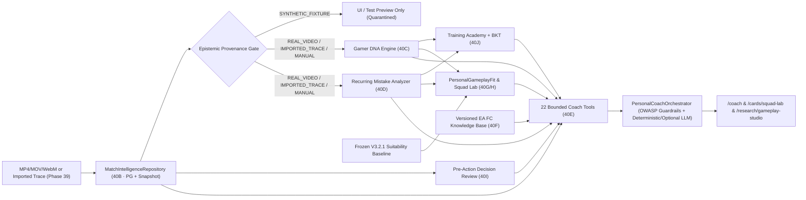

# PHASE 40: Unified System Architecture

## 1. End-to-End Closed-Loop Pipeline

## 2. Persistence Schema (`db/migrations/015_phase40_coaching_intelligence.sql`)

Nine PostgreSQL tables in `public` schema strictly foreign-keyed to `public.user_profile(id) ON DELETE CASCADE`, reversible via `db/migrations/rollback/015_phase40_coaching_intelligence_down.sql`:
- `phase40_match_squad_snapshot`: Immutable point-in-time XI snapshots (formation, roles, attributes, SHA-256).
- `phase40_match_record`: Versioned match storage supporting duplicate SHA-256 guards, partial matches, telemetry metrics, events, coaching findings, and clip deep-links.
- `phase40_gamer_profile`: Persistent self-reported cold-start preferences + observed Gamer DNA cache.
- `phase40_recurring_mistake`: Normalized longitudinal mistake patterns & hypotheses.
- `phase40_training_plan` & `phase40_training_attempt`: Temporal-occlusion challenges & BKT mastery history.
- `phase40_coach_session` & `phase40_coach_message`: Structured auditable Q&A logs.
- `phase40_knowledge_entry`: Official facts & methodology registry schema.

## 3. Core API Surface (`/api/phase40/*`)

Mounted cleanly in `backend/api/main.py` via `backend/api/routes/phase40_coach.py`:
- `GET /api/phase40/health` & `GET /api/phase40/knowledge`
- `POST /api/phase40/matches`, `POST /api/phase40/matches/from-video/{video_id}`, `GET/DELETE /api/phase40/matches/{id}`, `GET /api/phase40/matches/compare/{a}/{b}`
- `GET /api/phase40/gamer-dna`, `POST /api/phase40/gamer-dna/cold-start`, `GET /api/phase40/recurring-mistakes`
- `POST /api/phase40/coach/ask`, `GET /api/phase40/coach/messages`
- `GET /api/phase40/recommendations/personal-fit`, `POST /api/phase40/squad-intelligence/analyze`
- `POST /api/phase40/decision-review`, `GET /api/phase40/training/plan`, `POST /api/phase40/training/attempt`, `GET /api/phase40/progression`
- `DELETE /api/phase40/privacy/reset` (full user-scoped wipe)
