# Phase 41.5 Provider Architecture — Hybrid Agentic AI Coach

**Date:** 2026-11-25  
**Principle:** *Our engine calculates. The LLM retrieves via typed tools, reasons, and explains. Validated backend evidence remains the sole source of truth.*

---

## 1. Module Topology (`backend/services/llm/`)

| Component | Module | Responsibility |
| :--- | :--- | :--- |
| **`FootballLLMProvider`** | [contracts.py](../../backend/services/llm/contracts.py) | Provider-agnostic ABC defining `generate()`, `generate_stream()`, `health_check()`, normalized `LLMMessage`, `LLMToolSpec`, `LLMToolCall`, `LLMResponse`, and classified `ProviderError`. |
| **`GeminiProvider`** | [gemini_provider.py](../../backend/services/llm/gemini_provider.py) | Official `google-genai` SDK (`from google import genai; types.GenerateContentConfig`) adapter supporting API key auth, `FunctionDeclaration` schemas with automatic function calling disabled (`disable=True` so orchestrator owns tool execution), native Pydantic JSON `response_json_schema`, SSE `generate_content_stream()`, cancellation events, timeout enforcement, and secret redaction. |
| **`OpenRouterProvider`** | [openrouter_provider.py](../../backend/services/llm/openrouter_provider.py) | `httpx` REST & SSE client for `https://openrouter.ai/api/v1/chat/completions`, passing `provider: {"allow_fallbacks": false, "require_parameters": true, "max_price": {"prompt": 0, "completion": 0}}`, OpenAI-compatible `tools`, incremental SSE tool-call argument assembly, JSON repair, and `Retry-After` parsing. |
| **`FreeUsageGuard` & `QuotaManager`** | [free_guard.py](../../backend/services/llm/free_guard.py) | Pre-flight paid-model / disallowed-provider blocker, per-turn request tracker (`TurnBudgetTracker`), sliding-window RPM & per-user RPM, daily provider cap, bounded concurrency semaphore, and per-model/provider HTTP 429 cooldowns. |
| **`ModelCapabilityRegistry` & `ProviderHealthMonitor`** | [registry.py](../../backend/services/llm/registry.py) | TTL-cached discovery (`AI_COACH_CATALOG_REFRESH_SECONDS=1800`) querying Gemini `/v1beta/models` and OpenRouter `/api/v1/models`, automatically pruning unavailable models and tracking latency EMA + failure counts. |
| **`FootballModelRouter`** | [router.py](../../backend/services/llm/router.py) | Task-aware router (`TaskIntent`) ordering verified free candidates (`Gemini Free -> OpenRouter Free -> DeterministicCoachFallback`), skipping cooled-down models without wasting turn request budget, and normalizing `LLMMessage` history across providers. |
| **Security & Redaction** | [security.py](../../backend/services/llm/security.py) | Key/token pattern redaction (`redact_secrets`, `redact_dict`), untrusted input sanitization, and default-disabled external image/video consent & validation (`check_media_transmission_allowed`). |

---

## 2. Gemini vs OpenRouter Routing & Failover Flow

```mermaid
flowchart LR
    U[User Question] --> SEC[OWASP Injection & Privacy Gate]
    SEC --> INT[TaskIntent Classification + Preflight Evidence Check]
    INT --> DET[Baseline Deterministic Engine Tools]
    DET --> OPT{External Free AI Enabled & Consented?}
    OPT -- No / Legacy Provider --> DFB[DETERMINISTIC_COACH Response]
    OPT -- Yes --> RTR[FootballModelRouter + FreeUsageGuard]
    RTR --> GEM["Gemini Free API (gemini-4-hydrogen / gemini-3.8-flash / 3.6-flash)"]
    GEM -- Success / Tool Loop --> VAL[Anti-Hallucination & Secret Redact Validator]
    GEM -- 429 / 503 / Timeout / Unavailable --> NORM[Normalize Conversation State]
    NORM --> OR["OpenRouter Free (openrouter/free / nemotron-3.5-super-vl:free / ernie-5.5:free)"]
    OR -- Success / Tool Loop --> VAL
    OR -- Quota / Error / Cancelled --> DFB
    VAL --> RES[StructuredCoachResponse + Persistent History]
```

---

## 3. Gemini `gemini-api-dev` Skill Alignment

Evaluation of `google-gemini/gemini-skills` (`gemini-api-dev`):
- Replaced legacy `google-generativeai` references strictly with `google-genai>=1.0.0` (`from google import genai`).
- Uses `types.GenerateContentConfig`, `types.HttpOptions(timeout=...)`, and `types.FunctionDeclaration(parameters_json_schema=...)`.
- Enforces `automatic_function_calling=types.AutomaticFunctionCallingConfig(disable=True)` so every LLM tool request passes through our Pydantic validation, duplicate detector, and user-ID authorization layer before execution.
- Rejects deprecated model aliases (`gemini-2.5-flash` 404 for new keys) cleanly and promotes live verified `gemini-4-hydrogen` / `gemini-3.8-flash` / `gemini-3.6-flash`.
